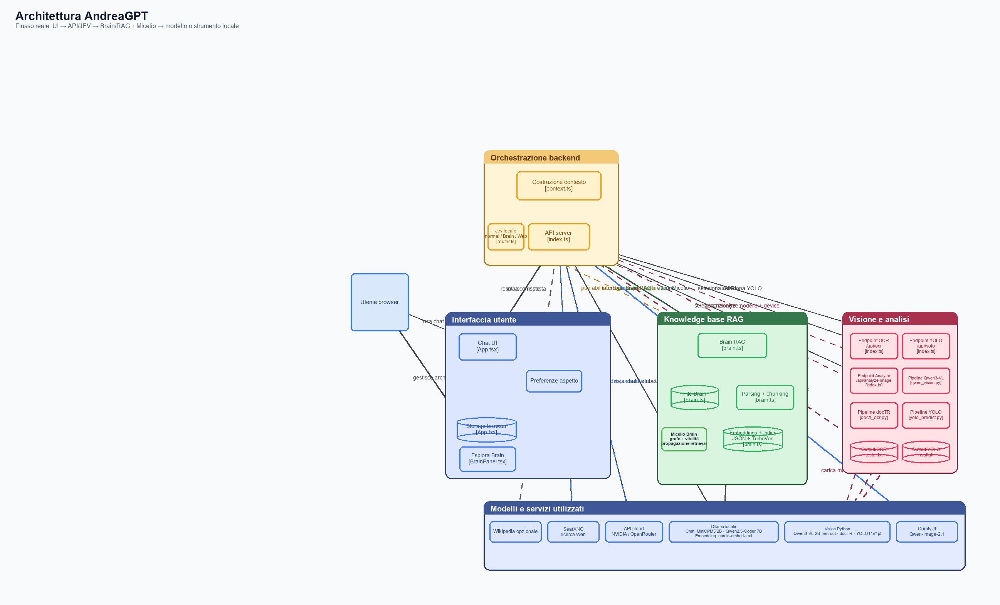

# AndreaGPT

AndreaGPT è un assistente locale basato su Ollama. L'applicazione combina una chat web, un router locale, il repository Brain/RAG, il grafo semantico Micelio, l'acceleratore TurboVec e strumenti locali o web.

## Mappa dell'architettura

- [Schema modificabile Draw.io](DRAW/architettura-andreagpt.drawio)
- [Schema SVG](DRAW/architettura-andreagpt.svg)

Il flusso principale è:

~~~
Browser / App.tsx
        |
        v
API server / backend/index.ts
        |
        v
Router locale --- Web/SearXNG
        |
        v
Brain RAG
  |       |
  |       +--> TurboVec / indice vettoriale
  v
Micelio: grafo, vitalità, propagazione dei punteggi
        |
        v
Contesto selezionato ---> Ollama ---> risposta e diagnostica
~~~

Questa è la distinzione fondamentale: AndreaGPT non è un unico modello addestrato. È un'orchestrazione di componenti che preparano il contesto, scelgono il percorso e chiedono una risposta a un modello già addestrato.

## Dove si trova ogni componente

| Componente | Dove si trova | Cosa fa | Cosa non fa |
|---|---|---|---|
| Router locale | <code>backend/router.ts</code> e <code>backend/index.ts</code> | Decide il percorso normale, Brain o Web quando non è stato scelto manualmente | Non addestra il modello e non corregge automaticamente una risposta |
| Brain / RAG | <code>backend/brain.ts</code> | Legge documenti, crea chunk ed embeddings, recupera contenuti e costruisce contesto | Non modifica i pesi di Ollama |
| Micelio | Logica in <code>backend/brain.ts</code>, UI in <code>frontend/BrainGraph.tsx</code> | Collega nodi semantici, usa vitalità e propagazione per influenzare il ranking | Non è training e non rende vera una risposta solo perché lo score è alto |
| TurboVec | <code>backend/utils/turbovec_bridge.py</code> e file <code>.turbovec</code> | Accelera la ricerca dei vicini nell'indice vettoriale | Non è un modello linguistico |
| Ollama | Provider locale configurato nell'app | Genera la risposta usando il modello scelto | Non conosce automaticamente i documenti del progetto |
| Embedding model | Modello configurato per gli embeddings, normalmente <code>nomic-embed-text</code> | Trasforma testo in vettori numerici | Non genera la risposta della chat |
| Web / SearXNG | Servizio <code>searxng</code> in Docker | Cerca fonti esterne quando Web è attivo | Non sostituisce il Brain locale |
| Feedback | <code>ANDREA-BRAIN/.index/feedback.json</code> | Conserva segnali utili al ranking e alla diagnosi | Non è un dataset di training automatico |

## Router locale, in parole semplici

Il router locale è il livello di decisione prima della generazione:

~~~
richiesta utente
      |
      +--> normale: Ollama risponde direttamente
      +--> Brain: recupera documenti locali e li passa a Ollama
      +--> Web: cerca fonti esterne e le passa a Ollama
~~~

Il router usa una confidenza. Se la confidenza è sotto soglia può registrare un warning e mantenere comunque il percorso normale. Questo significa che la decisione del router è poco sicura, non che Ollama sia guasto.

Se l'utente attiva esplicitamente Brain o Web, il percorso manuale deve avere precedenza sul router automatico. Per questo una richiesta locale può funzionare mentre la stessa richiesta con Web attivo può fallire: il problema può essere nel percorso Web, in SearXNG, nella rete o nella validazione delle fonti.

## Brain / RAG

Il Brain segue questa sequenza:

1. legge i file validi dal repository Brain;
2. estrae e normalizza il testo;
3. divide il testo in chunk;
4. calcola gli embeddings;
5. salva l'indice JSON e, se disponibile, l'indice TurboVec;
6. cerca i chunk vicini alla domanda;
7. combina similarità testuale, vettoriale, eventuale feedback e Micelio;
8. costruisce il contesto inviato al modello;
9. restituisce fonti, score e diagnostica.

Struttura tipica:

~~~
ANDREA-BRAIN/
├── documents/              documenti indicizzati
├── progetti/               materiali di progetto
└── .index/
    ├── index.json           indice principale e metadati
    ├── index.tvim           indice TurboVec, se generato
    ├── index.turbovec.json  metadati TurboVec
    └── feedback.json        segnali di feedback/ranking
~~~

Dopo aver aggiunto o modificato file bisogna eseguire la reindicizzazione dal pannello Brain. La reindicizzazione non è addestramento: aggiorna l'indice usato nelle ricerche successive.

Un PDF può produrre warning se contiene soprattutto pagine scansionate o immagini. In quel caso il file viene visto, ma il testo può non essere indicizzabile senza OCR.

## Micelio

Micelio è un grafo sopra il retrieval. Un nodo rappresenta un'unità indicizzata, normalmente un documento o un chunk. Gli archi rappresentano vicinanza o collegamento semantico. La vitalità indica quanto un nodo è attivo o utile nel grafo.

~~~
query
  |
  v
nodo più vicino
  |
  +--> nodi vicini semanticamente
          |
          +--> propagazione controllata dello score
                  |
                  v
             ranking finale Brain
~~~

Micelio può distribuire il recupero tra contenuti collegati, ma non è una rete neurale e non modifica i pesi del modello. Il punteggio <code>micelioSupportScore</code> è un indicatore euristico di allineamento tra domanda, risposta, fonti recuperate e coesione del grafo. È utile per diagnosticare il retrieval, non è una misura di verità.

Un punteggio alto può accompagnare una risposta sbagliata se il contesto è semanticamente vicino ma non contiene la risposta esatta. Per valutare l'effetto di Micelio bisogna separare:

~~~
1. modello senza Brain
2. Brain/RAG senza propagazione Micelio
3. Brain/RAG con propagazione Micelio
~~~

Confrontare solo “senza Brain” e “con Brain + Micelio” misura l'intero percorso RAG, non l'effetto isolato di Micelio.

## TurboVec

TurboVec è un acceleratore di ricerca dei vettori. Riduce il tempo necessario per trovare i candidati più vicini in un indice grande; non genera testo, non decide se una risposta è vera e non sostituisce Ollama.

~~~
testo --> embedding --> indice TurboVec --> candidati vicini --> Brain/Micelio --> contesto
~~~

Se TurboVec non è disponibile, il Brain può usare un fallback JSON o una ricerca alternativa, con possibile aumento della latenza.

## Moduli disponibili

| Modulo | Funzione |
|---|---|
| Chat | Conversazione con Ollama |
| Brain | Recupero dai documenti locali |
| Micelio | Visualizzazione del grafo e dei collegamenti semantici |
| Web | Ricerca tramite SearXNG |
| OCR | Estrazione testo da immagini o documenti |
| YOLO | Rilevamento oggetti tramite modello locale |
| Analyze | Analisi di un contenuto o allegato |
| Image | Generazione o gestione immagini, se configurata |
| Converti | Conversione dei documenti |
| News | Ricerca o gestione di notizie |

OCR, YOLO e Image sono percorsi separati: non vengono automaticamente usati da una normale domanda di testo.

## Modelli e runtime effettivi

| Funzione | Modello/runtime | Codice o configurazione |
|---|---|---|
| Chat locale | <code>openbmb/minicpm5-2b:latest</code> e <code>qwen2.5-coder:7b</code> | <code>backend/models.ts</code>, Ollama |
| Embeddings Brain | <code>nomic-embed-text</code> | <code>backend/brain.ts</code> |
| OCR | docTR pretrained, oppure Tesseract come fallback | <code>backend/utils/doctr_ocr.py</code>, <code>OCR_ENGINE</code> |
| YOLO | <code>yolo11n.pt</code>, <code>yolo11n-seg.pt</code>, <code>yolo11n-cls.pt</code>, <code>yolo11n-pose.pt</code>, <code>yolo11n-obb.pt</code> | <code>backend/index.ts</code>, <code>backend/yolo_predict.py</code>, <code>YOLO_MODEL</code> |
| Analyze immagini | <code>Qwen/Qwen3-VL-2B-Instruct</code> | <code>backend/model/qwen_vision.py</code>, <code>VISION_MODEL</code> |
| Generazione immagini | <code>Qwen/Qwen-Image-2.1</code> tramite ComfyUI | <code>backend/model/qwen_image.py</code>, <code>IMAGE_MODEL</code> |
| Web | SearXNG, non un modello generativo | servizio Docker <code>searxng</code> |
| Modelli cloud | NVIDIA API e OpenRouter | <code>backend/models.ts</code>, chiavi nel <code>.env</code> |

<code>Router locale</code> nel diagramma indica il router euristico di <code>backend/router.ts</code>.

## Schemi Draw.io

Gli schemi modificabili sono nella cartella <code>DRAW</code>:

| Area | Draw.io | Anteprima |
|---|---|---|
| Architettura completa | [architettura-andreagpt.drawio](DRAW/architettura-andreagpt.drawio) | [PNG](DRAW/architettura-andreagpt.png) · [SVG](DRAW/architettura-andreagpt.svg) |
| Router locale | [router.drawio](DRAW/router.drawio) | [SVG](DRAW/router.svg) |
| Brain/RAG | [rag.drawio](DRAW/rag.drawio) | [SVG](DRAW/rag.svg) |
| Micelio e TurboVec | [micelio-turbovec.drawio](DRAW/micelio-turbovec.drawio) | [SVG](DRAW/micelio-turbovec.svg) |
| Pipeline immagini | [qwen-image-2.1.drawio](DRAW/qwen-image-2.1.drawio) | [SVG](DRAW/qwen-image-2.1.svg) |

Per rigenerare l'anteprima dello schema principale:

~~~powershell
node .\scripts\render-drawio-svg.mjs .\DRAW\architettura-andreagpt.drawio .\DRAW\architettura-andreagpt.svg
& 'C:\Program Files\Google\Chrome\Application\chrome.exe' --headless --no-sandbox --screenshot='.\DRAW\architettura-andreagpt.png' 'file:///C:/Users/andre/Desktop/AndreaGPT/DRAW/architettura-andreagpt.svg'
~~~

Il file <code>.drawio</code> resta la fonte modificabile. SVG e PNG sono derivati usati per documentazione e anteprime.

## Avvio locale

Prerequisiti:

- Docker Desktop;
- Node.js 22 per sviluppo locale;
- Ollama;
- modelli Ollama necessari, per esempio:

~~~powershell
ollama pull qwen2.5-coder:7b
ollama pull nomic-embed-text
~~~

Avvio consigliato:

~~~powershell
docker compose up -d --build
docker compose ps
~~~

Poi aprire <code>http://localhost:3000</code>.

In alternativa:

~~~powershell
.\Avvia-AndreaGPT.bat
~~~

Se Docker segnala `lookup registry-1.docker.io: no such host`, lo script tenta
automaticamente l'avvio dalle immagini locali, senza build o download. In questo
caso le ultime modifiche al codice non vengono applicate. Se le immagini non sono
disponibili, occorre ripristinare la connessione/DNS di Docker Desktop e ripetere
l'avvio. Per avviare manualmente la versione locale:

~~~powershell
docker compose up -d --no-build --pull never
~~~

Se Chrome mostra <code>ERR_CONNECTION_REFUSED</code>, controllare:

~~~powershell
docker compose ps
docker compose logs --tail=100 andreagpt
docker compose port andreagpt 3000
~~~

Se il container è stato ricreato, fare un hard refresh del browser. Un aggiornamento di Docker Desktop da solo non garantisce che il container AndreaGPT sia ancora avviato.

## Accesso da telefono o LAN

Nel file <code>.env</code>, se il progetto deve essere esposto nella rete locale:

~~~dotenv
APP_BIND_ADDRESS=0.0.0.0
LAN_ACCESS=1
~~~

Dal telefono usare l'indirizzo IP attuale del computer, per esempio <code>http://192.168.1.106:3000</code>. L'indirizzo può cambiare con il DHCP e non va fissato nel codice.

Se <code>localhost:3000</code> non funziona sul PC, il problema non è il telefono: prima va risolto l'avvio del container.

## Configurazione importante

| Variabile | Scopo |
|---|---|
| <code>APP_PORT</code> | Porta HTTP dell'app |
| <code>APP_BIND_ADDRESS</code> | Indirizzo su cui ascolta il server |
| <code>LAN_ACCESS</code> | Abilita l'uso dalla rete locale |
| <code>BRAIN_TURBOVEC</code> | Abilita o disabilita TurboVec |
| <code>RAG_OPTIMIZE</code> | Ottimizzazioni del recupero Brain |
| <code>BRAIN_EMBED_BATCH</code> | Dimensione batch per gli embeddings |
| <code>BRAIN_MAX_CONCURRENCY</code> | Concorrenza della fase di indicizzazione |
| <code>ROUTER_ENABLED</code> | Abilita il router automatico |
| <code>ROUTER_CONFIDENCE_THRESHOLD</code> | Soglia di confidenza del router |
| <code>VISION_MAX_IMAGE_BYTES</code> | Limite per gli input immagine |

Le variabili effettive dipendono dal file <code>.env</code> e dal compose usato. Prima di modificarle controllare <code>docker-compose.yml</code> e <code>backend/index.ts</code>.

## Diagnostica

Il report diagnostico distingue normalmente:

- <code>REQUEST</code>: richiesta validata;
- <code>Router</code>: decisione e confidenza del router;
- <code>MODEL</code>: Ollama ha accettato la richiesta;
- <code>RESPONSE</code>: generazione conclusa;
- <code>semanticSupportChecked</code>: indica se è stato calcolato il supporto semantico Brain/Micelio;
- <code>micelioSupportScore</code>: indicatore di allineamento del percorso di retrieval.

<code>semanticSupportChecked: false</code> significa che il controllo non è stato eseguito, non che la risposta sia semanticamente falsa. Può accadere quando non ci sono fonti Brain, Brain non è stato richiesto o il percorso non ha dati da confrontare.

Un warning come <code>confidence below threshold</code> indica una decisione del router poco sicura. Non è necessariamente un errore di generazione.

## Brain e Web: perché uno funziona e l'altro no

Sono percorsi diversi:

~~~
Chat locale --> Ollama --> risposta
Chat + Web  --> Router --> SearXNG --> fonti --> Ollama --> risposta
~~~

Un errore Web può dipendere da SearXNG non healthy, rete Docker, timeout, nessun risultato valido o formato delle fonti. Per diagnosticarlo:

~~~powershell
docker compose ps
docker compose logs --tail=100 searxng
docker compose logs --tail=100 andreagpt
~~~

## Qualità delle risposte

Per distinguere una traduzione sbagliata da un'allucinazione:

1. mantenere in inglese i termini tecnici come <code>Transformer</code>, <code>embedding</code>, <code>token</code>, <code>training</code>, <code>inference</code>, <code>retrieval</code>, <code>router</code>, <code>OCR</code>, <code>YOLO</code> e <code>API</code>;
2. chiedere al modello di rispondere in italiano senza tradurre quei termini;
3. con Brain attivo controllare le fonti e il testo citato;
4. non interpretare un <code>micelioSupportScore</code> alto come prova di correttezza;
5. confrontare modello solo, Brain senza Micelio e Brain con Micelio;
6. usare temperatura bassa per test ripetibili.

Prompt consigliato:

~~~text
Rispondi in italiano. Mantieni in inglese i termini tecnici e i nomi delle tecnologie.
Non tradurre termini come Transformer, embedding, token, training, inference, retrieval,
router, OCR, YOLO e API. Se non hai evidenza sufficiente, dichiaralo esplicitamente.
~~~

## Sviluppo e controlli

~~~powershell
npm install
npm run check
npm test
npm run build
~~~

Dopo una modifica al codice:

~~~powershell
docker compose up -d --build
docker compose config
~~~

## Limiti attuali

### Retrieval misurabile e agente codice

Il deployment Compose usa `BRAIN_RETRIEVAL_BACKEND=sqlite`: lo snapshot operativo
contiene testo e metadati in SQLite FTS5, vettori originali binari e indici TurboVec.
L'indice JSON viene conservato per manutenzione, reindicizzazione e rollback; la
ricerca ordinaria e il grounding non devono caricarlo quando lo snapshot è valido.
Le viste complete del grafo e la manutenzione usano ancora il formato originale.
Alla prima richiesta Brain lo snapshot mancante viene costruito in background:
durante la costruzione, oppure se è obsoleto, la ricerca usa il percorso legacy.
Ogni snapshot verifica dimensione e data di modifica della sorgente e viene
pubblicato attraverso un manifest atomico; le generazioni precedenti restano disponibili.

Configurazione conservativa: `BRAIN_PCA_DIM=768`, `BRAIN_VECTOR_CANDIDATES=96`,
`BRAIN_PRECOMPUTED_GRAPH=0`. PCA 384/256 e grafo precalcolato sono disponibili per
esperimenti, ma non vengono attivati automaticamente. La PCA normalizza i vettori,
sottrae la media appresa sui documenti, proietta e normalizza di nuovo. Il ranking
finale usa sempre il coseno originale dei soli candidati, senza mescolare scale.

I report diagnostici includono `indexStatusMs`, `indexLoadMs`, `queryPrepareMs`,
`embeddingMs`, `ftsMs`, `turboVecMs`, `candidateLoadMs`, `rankingMs`, `graphMs`,
`selectionMs`, `promptBuildMs` e `groundingMs`. FTS ed embedding si sovrappongono:
i tempi delle singole fasi non vanno sommati per ottenere il totale. Il totale
finale include il grounding, e quest'ultimo riusa il vettore della richiesta.
Il controllo rapido segnala citazioni mancanti/inesistenti e numeri assenti dalla
fonte citata: non certifica la verità di una frase. Il badge Affinità è somiglianza,
non probabilità di correttezza.

Per riprodurre gli esperimenti nel container con i sorgenti aggiornati:

~~~sh
docker compose exec andreagpt /opt/doctr/bin/python backend/brain/brain_store.py --source /app/ANDREA-BRAIN/.index/index.json --output /app/ANDREA-BRAIN/.index/retrieval
npm run benchmark:retrieval -- runtime/benchmarks/retrieval.json
~~~

Il benchmark Node richiede Ollama raggiungibile e `TURBOVEC_PYTHON` con numpy e
turbovec installati. Può essere eseguito in un container con `scripts/` montata e
una cartella di output scrivibile. Il secondo benchmark separa la recall dei
candidati dalla qualità delle risposte:

~~~sh
python scripts/benchmark/benchmark_pca.py --root ANDREA-BRAIN/.index/retrieval --queries runtime/benchmarks/retrieval-queries.json --output runtime/benchmarks/pca-recall.json
~~~

Il pulsante **Codice** abilita un agente locale che cerca simboli, legge file
attuali, trova chiamate e propone sostituzioni validate con hash. L'indice usa
l'AST TypeScript per TS/JS e `ast` per Python (senza eseguire i moduli), include import e intervalli di righe e viene aggiornato
quando cambiano i file. I riferimenti sono sintattici, non risoluzione completa dei
tipi. Impostare `CODE_WORKSPACE` per scegliere il progetto; in Compose il valore
iniziale è `/app/backend`. Un progetto esterno va montato in sola lettura.
Serve un modello Ollama con tool calling. Limiti: 6 iterazioni, 12 chiamate,
90 secondi, budget di contesto, massimo 2.000 file e 200 righe per lettura.
L'agente non esegue shell o test e non applica modifiche: le proposte sono mostrate
in chat. Le conversazioni restano private come quelle Brain.

Richiesto Node >=22.13 per `node:sqlite`. Per disattivare lo snapshot usare
`BRAIN_RETRIEVAL_BACKEND=legacy` e ricreare il servizio Compose; PCA non richiede
nuove chiamate al modello embedding, ma costruisce indici aggiuntivi sul disco.

- Micelio organizza e pesa il retrieval: non fa fine-tuning.
- TurboVec accelera la ricerca: non produce testo.
- Un embedding misura vicinanza semantica, non correttezza fattuale.
- Il feedback modifica il ranking solo se il relativo percorso lo legge.
- Dopo nuovi file serve reindicizzare il Brain.
- Un PDF scansionato può richiedere OCR.
- Brain e Web aggiungono latenza rispetto alla chat locale.
- Un modello piccolo può cambiare lingua o semplificare troppo: prompt e verifica delle fonti restano necessari.

## Regola mentale del progetto

~~~
Il router decide il percorso.
Brain trova il contesto.
Micelio organizza i collegamenti del contesto.
TurboVec accelera la ricerca.
Ollama genera la risposta.
La diagnostica misura cosa è successo.
~~~
