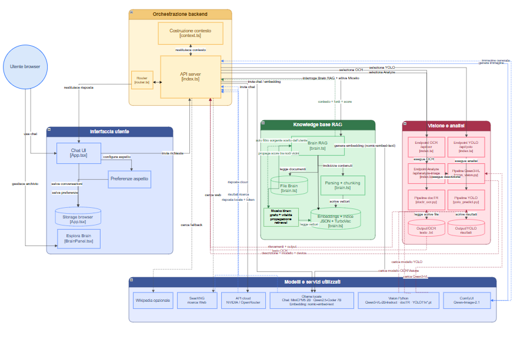
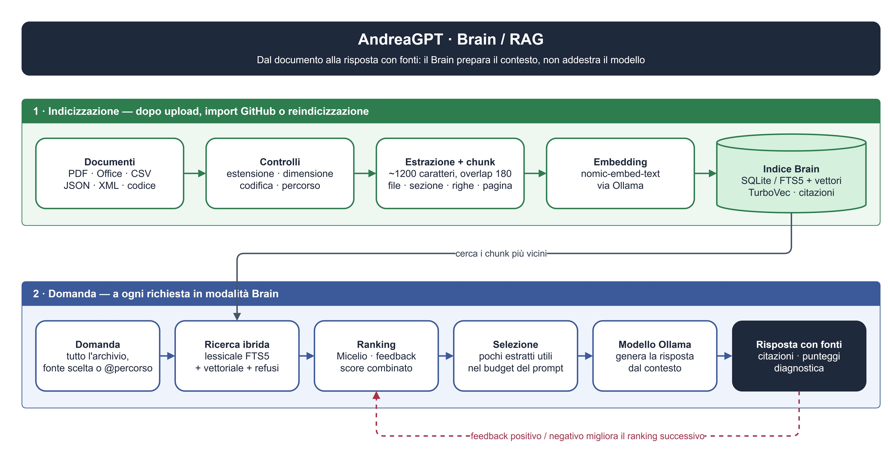
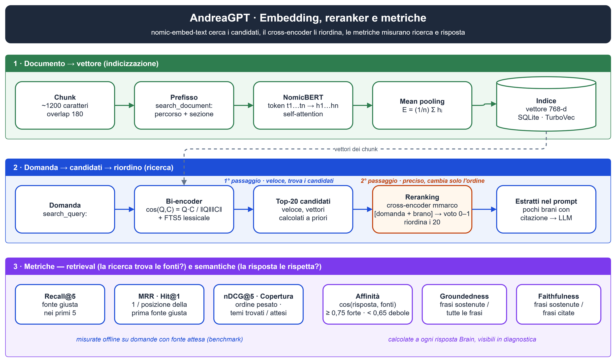
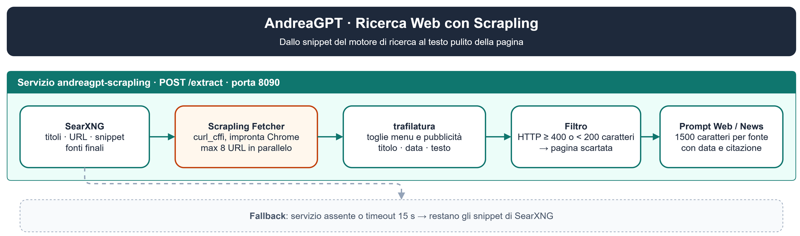
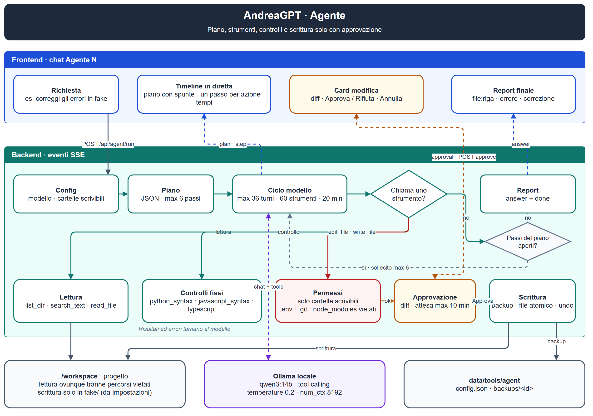

# AndreaGPT

AndreaGPT è un assistente simile a ChatGPT che funziona **sul tuo computer**. Lo
apri nel browser e ci scrivi come in una chat, ma le risposte le genera
un'intelligenza artificiale installata sul tuo PC, non un servizio su Internet.
Le domande e i documenti restano tuoi. Se vuoi, puoi anche scegliere un modello
online più potente; in quel caso la domanda viene inviata al servizio esterno.
AndreaGPT non ha inventato un'intelligenza artificiale nuova. Usa modelli già
esistenti, scaricati gratuitamente, e lavora attorno a loro: capisce che tipo di
richiesta hai fatto, recupera le informazioni utili e le passa al modello insieme
alla domanda. La chat si può usare in tre modi:

- **Solo il modello:** risponde con quello che ha imparato durante l'addestramento.
  È il modo più veloce, ma non conosce i fatti recenti né i tuoi file.
- **Con il Web:** prima di rispondere cerca su Internet e legge le pagine trovate.
  Serve per notizie e informazioni aggiornate.
- **Con il Brain:** risponde usando i **tuoi documenti** (PDF, Word, appunti…) e
  indica da quale file ha preso ogni informazione. In questo modo non va su
  Internet, quindi i documenti non escono dal computer.

Oltre alla chat ci sono strumenti per leggere il testo nelle immagini e nei PDF
(OCR), riconoscere oggetti nelle foto (YOLO), descrivere immagini, crearne di
nuove, trascrivere audio e convertire documenti. L'obiettivo è un assistente che lavora in locale. Il Web è un'opzione da attivare
quando serve.

> **Keyword:** LLM locale · Ollama · Qwen · Brain · RAG · Embedding · Reranking ·
> Cross-encoder · FTS5 · Vettori · TurboVec · Retrieval · Grounding · Metriche ·
> Shap · Ricerca Web · News · SearXNG · Scrapling · OCR · YOLO ·
> Segmentazione · Computer Vision · Generazione immagini · VAE · ComfyUI ·
> Whisper · Trascrizione audio · Conversione documenti · Agente di codice ·
> Docker · Privacy

## Brain: come funziona

Brain è l'archivio documentale interrogabile da AndreaGPT. Non è un modello
addestrato e non modifica i pesi di Ollama: prepara il contesto che il modello
userà per rispondere. Quando un documento viene caricato nel Brain, il sistema:

- controlla estensione, dimensione, codifica, percorso e sicurezza del file;
- estrae il testo da file, PDF, Office, CSV, JSON, XML e codice;
- divide il contenuto in chunk conservando file, sezione, righe e pagina;
- crea un embedding per ogni chunk con nomic-embed-text tramite Ollama;
- salva testo, metadati, vettori e citazioni nell'indice;
- costruisce lo snapshot SQLite/FTS5 e, se abilitato, l'indice TurboVec;
- combina ricerca lessicale, vettoriale, refusi e feedback;
- riordina i primi 20 candidati con un cross-encoder multilingue (reranker);
- seleziona pochi estratti pertinenti e li inserisce nel prompt;
- restituisce risposta, fonti, punteggi e diagnostica.

La configurazione predefinita usa chunk di circa 1200 caratteri con sovrapposizione
di 180 caratteri. Il Brain può cercare in tutto l'archivio oppure limitarsi a una
fonte selezionata dal pannello o indicata con @percorso. Dopo aver aggiunto o
modificato documenti bisogna reindicizzare. È possibile anche caricare nel Brain
i tuoi progetti pubblici inserendo il link del progetto, ad esempio:
https://github.com/Langiott/Pianeti_Stelle

## Embedding, reranker e metriche

### Modello per creare Embeddings 
**nomic-embed-text** è un modello che trasforma un brano di testo in una lista di
768 numeri, chiamata *embedding* o *vettore*. Questi numeri sono come le coordinate
di un punto su una mappa del significato: due brani che parlano della stessa cosa
finiscono in punti vicini, anche se usano parole diverse ("automobile" e "macchina"),
mentre brani su argomenti lontani finiscono in punti distanti. È così che il Brain
riesce a trovare un documento anche quando la domanda non contiene le sue stesse
parole.

Per costruire il vettore, ogni documento viene prima tagliato in pezzi di circa 1200
caratteri, i *chunk*, e ogni chunk viene spezzato in *token*, cioè parole o pezzi di
parola. Il modello (un Transformer della famiglia BERT, chiamato NomicBERT) legge
tutti i token insieme e, grazie alla *self-attention*, dà a ciascuno un significato
che dipende dalle parole vicine: "buco " in "buco nero" e in "fessura"
riceve due vettori $h_i$ diversi. Alla fine il *mean pooling* fa la media di tutti
questi vettori, $E_{chunk} = \frac{1}{n}\sum_{i=1}^{n} h_i$, e ottiene un unico
vettore che riassume l'intero chunk. Nomic vuole anche sapere che ruolo ha il testo,
per questo i chunk vengono preceduti da `search_document:` (insieme al nome del file
e della sezione) e le domande da `search_query:`.

Quando fai una domanda, anche lei diventa un vettore e il Brain la confronta con
tutti i chunk salvati usando la *similarità coseno*,
$\cos(Q,C) = \frac{Q \cdot C}{\lVert Q \rVert \lVert C \rVert}$, che misura quanto
due vettori puntano nella stessa direzione: vale circa 1 se domanda e chunk parlano
della stessa cosa e scende verso 0 se non c'entrano. A questo punteggio si aggiunge
la ricerca classica per parole esatte (FTS5 di SQLite), utile per nomi propri, codici
e sigle, e si ottengono i 20 chunk più promettenti.

### Reranking

La ricerca nel Brain avviene in due passaggi. Il primo (embedding + parole esatte) è
veloce perché domanda e documenti diventano vettori separatamente (*bi-encoder*): i
vettori dei documenti si calcolano una volta sola, al caricamento, e a ogni domanda
basta confrontare numeri. Così trova in fretta i 20 brani candidati, ma il modello non
legge mai domanda e brano uno accanto all'altro, quindi a volte mette in cima un brano
che parla dell'argomento senza rispondere davvero.

Il secondo passaggio, il **reranking**, corregge questo limite. Un **cross-encoder
multilingue** riceve insieme ogni coppia `[domanda + brano]`, la legge come farebbe
una persona e le dà un voto di pertinenza da 0 a 1, anche se domanda e documento sono
in lingue diverse; poi i 20 brani vengono rimessi in fila secondo quel voto. Non trova
brani nuovi, cambia solo l'ordine: è molto più preciso ma anche più lento, quindi non
scorre tutto l'archivio. L'ordine conta perché il modello riceve soltanto i primi
brani della fila: senza reranking, un brano giusto al decimo posto spesso non arriva
mai alla risposta. Su 98 domande di prova la fonte giusta al primo posto (Hit@1)
passa dal 63% all'85% e l'MRR da 0,73 a 0,91, al costo di circa 1,3 s su CPU.

### Metriche Utili 

**Retrieval: il Brain trova il brano giusto?**

| Metrica | Domanda a cui risponde | Esempio |
|---|---|---|
| **Recall@5** | Il brano giusto compare tra i primi 5 risultati? | Recall@5 = 0,8 =  8 domande su 10 sì|
| **Hit@1** | Il brano giusto è proprio il primo risultato? | Hit@1 = 0,6 =  6 domande su 10 il primo brano è quello giusto |
| **MRR** | In che posizione compare, in media, la fonte giusta? | Per ogni domanda  il Brain restituisce una classifica di risultati; il voto dipende da dove sta la fonte giusta in quella classifica: 1ª posizione = 1, 2ª = 0,5, 3ª = 0,33, 4ª = 0,25, 5ª = 0,2, assente = 0. MRR = media dei voti. Fonte giusta 1ª, 1ª e 2ª in tre domande: MRR = (1 + 1 + 0,5) / 3 = 0,83 |
| **nDCG@5** | Se i brani giusti sono più di uno, stanno tutti in cima? | nDCG@5= 1 = tutti i brani giusti occupano i primi 5 posti; scende se sono in fondo alla top 5 |
| **Copertura** | Per una domanda su due argomenti, li trova entrambi? | Copertura = 1 = li trova entrrambi , se Copertura = 0,5 ne trova solo uno  |

**Semantica: la risposta si basa davvero sui brani?**

| Metrica | Domanda a cui risponde | Esempio |
|---|---|---|
| **Groundedness** | Quante frasi della risposta sono confermate da una fonte? | Groundedness = 0,7 = 7/10 confermate; le altre 3 non hanno fonte di riferimento |
| **Faithfulness** | Delle frasi con una citazione [N], quante sono davvero confermate dalla fonte citata? | Faithfulness =  3/6 = 0,5	se le citazioni che mette sono vere: metà no |
| **Copertura citazioni** | Quante frasi della risposta hanno una citazione [N]? | Copertura citazioni =  0,4 = 4 frasi su 10 citano una fonte, 6 no |
| **Affinità** | La risposta parla dello stesso argomento delle fonti? | Affinità = 0,78; calcolo coseno tra l'embedding della risposta e quello delle fonti usate. A> 0,75 stesso tema , se 0,65 a 0,75 temi simili , sotto 0,65 o inferiori probabilmente fuori tema. Non dice se la risposta è vera|

## Modelli e Librerie utilizzate

| Funzione | Modello o motore | Parametri | Utilizzo |
|---|---|---|---|
| Chat locale rapida | [openbmb/minicpm5-2b](https://github.com/OpenBMB/MiniCPM):latest | 2,5B | Chat, scrittura, Brain e codice con bassa latenza |
| Chat locale ragionata | [qwen3:14b](https://ollama.com/library/qwen3) | 14B | Ragionamento, italiano, codice e Brain |
| Coding locale | [qwen3-coder:30b-a3b-q4_K_M](https://ollama.com/library/qwen3-coder) | 30B (3B attivi) | Repository, codice e agente locale |
| Embedding Brain | [nomic-embed-text](https://ollama.com/library/nomic-embed-text) | 137M | Trasforma documenti e query in vettori |
| Reranker Brain | [cross-encoder/mmarco-mMiniLMv2-L12-H384-v1](https://huggingface.co/cross-encoder/mmarco-mMiniLMv2-L12-H384-v1) | 118M | Riordina i 20 candidati leggendo domanda e brano insieme |
| Visione Analyze | [Qwen/Qwen3-VL-2B-Instruct](https://huggingface.co/Qwen/Qwen3-VL-2B-Instruct) | 2B | Descrizione e analisi delle immagini |
| OCR principale | [docTR](https://github.com/mindee/doctr) pretrained | 40M | Lettura del testo da immagini e PDF |
| OCR fallback | [Tesseract](https://github.com/tesseract-ocr/tesseract) | — | Alternativa quando docTR non è disponibile |
| YOLO | [yolo11n.pt](https://docs.ultralytics.com/models/yolo11/) e varianti | 2,6M | Detection, segmentazione, classificazione, pose e OBB |
| Generazione Image | [Qwen/Qwen-Image-2.1](https://huggingface.co/Qwen/Qwen-Image-2.1) | — | Generazione immagini tramite [ComfyUI](https://github.com/comfyanonymous/ComfyUI) |
| Generazione rapida | [Viggle/Qwen-Image-2.1-viggle-turbo-v0.2.1](https://huggingface.co/Viggle/Qwen-Image-2.1-viggle-turbo) | — | Variante veloce a pochi step |
| Cloud | [GLM 5.2](https://z.ai) via [OpenRouter](https://openrouter.ai) | — | Ragionamento e coding a lungo contesto |
| Cloud | [Gemma 4 31B](https://ai.google.dev/gemma) via OpenRouter | 31B | Modello multimodale Google |
| Cloud | [MiniMax M3](https://www.minimax.io) via [NVIDIA API](https://build.nvidia.com) | — | Conversazione e contenuti generalisti |
| Ricerca Web | [SearXNG](https://github.com/searxng/searxng), Scrapling, [Firecrawl](https://www.firecrawl.dev), [Perplexity](https://docs.perplexity.ai) | — | Fonti aggiornate, testo delle pagine e News |

La lista [Ollama](https://ollama.com) viene aggiornata interrogando il catalogo locale: ogni modello
installato con ollama pull può comparire nell'interfaccia. I modelli cloud
richiedono le rispettive chiavi API.

## TurboVec: come funziona

TurboVec è l'acceleratore della ricerca vettoriale. Il calcolo resta lo stesso, cioè
il coseno tra domanda e chunk; cambia **su quali numeri** e **quante volte** lo si
fa per intero. Senza TurboVec, a ogni domanda bisognerebbe calcolare il coseno esatto con *tutti* i
chunk: ognuno ha 768 numeri in virgola mobile da 4 byte, cioè 3 KB da leggere per
chunk. Con migliaia di chunk il tempo se ne va soprattutto a leggere questi dati
dalla memoria, più che a moltiplicarli. TurboVec accelera in tre modi:

1. **Vettori compressi.** Alla costruzione dell'indice ogni numero viene ridotto a
   4 bit (`bit_width=4`, calibrato su un campione di chunk): un chunk passa da 3 KB
   a 384 byte, 8 volte meno dati da leggere a ogni domanda.
2. **Calcolo in codice nativo.** Il confronto con i vettori compressi gira in codice
   compilato che elabora molti numeri per istruzione, dentro un processo che tiene
   l'indice già caricato in memoria. Il percorso senza TurboVec, invece, scorre
   array JavaScript e rilegge l'indice JSON.
3. **Coseno esatto solo sulla shortlist.** Il punteggio sui vettori compressi è
   approssimato e serve solo a scegliere i 96 chunk più vicini
   (`BRAIN_VECTOR_CANDIDATES`). Solo su questi, più quelli trovati da FTS5, il
   Brain ricalcola il coseno esatto con i vettori originali: il punteggio finale è
   identico a quello di un confronto completo.

Il prezzo è l'approssimazione del primo passaggio: un chunk molto vicino alla soglia
può restare.

## Ricerca Web e Scrapling

SearXNG restituisce titoli, URL e snippet di poche righe, spesso insufficienti per
rispondere. Per questo le fonti finali delle modalità Web e News passano dal servizio
**Scrapling**, che con una sola chiamata `POST /extract` scarica fino a 8
pagine in parallelo. [Scrapling](https://github.com/D4Vinci/Scrapling) usa il `Fetcher`
HTTP basato su curl_cffi, che imita l'impronta TLS e gli header di Chrome e segue i
redirect, così molti siti che bloccano i client automatici rispondono normalmente;
l'immagine installa solo `scrapling[fetchers]`, senza browser headless, e resta leggera.
L'HTML viene poi ripulito da **trafilatura**, che toglie menu, commenti e pubblicità ed
estrae titolo, data di pubblicazione e testo principale. Le pagine con errore HTTP o con
meno di 200 caratteri utili vengono scartate e ogni fonte entra nel prompt con al
massimo 1500 caratteri, data e citazione. Se il servizio non risponde entro 15 secondi
il backend continua con gli snippet di SearXNG, quindi Scrapling migliora le risposte
ma non è mai un punto di blocco.

## Agente: come funziona

Il pulsante **Agente** apre una chat dedicata ("Agente N") in cui un modello locale
lavora sui file del progetto tramite strumenti. Tutto gira su Ollama, nessun dato esce
dal PC.

| Fase | Cosa succede |
|---|---|
| **Piano** | Il modello scompone la richiesta in massimo 6 passi, mostrati come checklist. |
| **Ciclo** | A ogni turno il modello chiama uno strumento o scrive il report. Limiti: 36 turni, 60 strumenti, 20 minuti. |
| **Lettura** | `list_dir`, `search_text`, `read_file` su tutto il progetto, esclusi `.env`, `.git`, `node_modules`, `data`, `runtime` e file con chiavi o password. |
| **Controlli** | Solo controlli fissi, nessun comando libero: `python_syntax`, `javascript_syntax`, `typescript` (strict). |
| **Scrittura** | `edit_file` e `write_file` solo nelle cartelle scrivibili (Impostazioni → Agente, default `fake`). Ogni modifica mostra il diff e attende **Approva / Rifiuta**; dopo l'approvazione c'è backup automatico e **Annulla**. |
| **Report** | Per ogni problema: `file:riga`, errore, correzione applicata o proposta. |

Ogni azione compare in diretta come riga della timeline (eventi SSE da
`POST /api/agent/run`). Se il modello si ferma con passi del piano ancora aperti viene
sollecitato a continuare (massimo 6 volte). I contenuti dei file sono trattati come dati:
eventuali istruzioni scritte dentro vengono ignorate.

**Configurazione.** Modello e cartelle scrivibili si scelgono in Impostazioni → Agente
(salvati in `data/tools/agent/config.json`). Modello consigliato `qwen3:14b`, che va
scaricato con `ollama pull qwen3:14b`. I permessi sono applicati dal backend, non dal
prompt.

**Benchmark.** `fake/` contiene 5 file con 7 errori (sintassi, tipi, runtime, logica).
`npx tsx scripts/test/smoke_agent.ts` avvia l'agente, approva le modifiche e confronta il
risultato con `scripts/test/agent_fake_key.json`; `npx tsx scripts/test/agent_fake_reset.ts`
ripristina i file originali.

## Diagnostica: Fonti, Tempi, Log, Semantic e Shap

Sotto ogni risposta compaiono dei pulsanti che aprono pannelli chiusi per default e
mostrano cosa è successo dietro le quinte. Si attivano da Impostazioni → Diagnostica e
ognuno risponde a una domanda diversa: da dove viene la risposta, quanto ci ha messo,
cosa è andato storto, dove il modello era insicuro e perché la ricerca ha scelto
quelle fonti.

**Fonti Brain / Fonti Web** mostrano i brani che il modello ha davvero ricevuto per
rispondere, con lo stesso numero che compare nelle citazioni `[Cit. n]` del testo. Per
il Brain si vede il file con le righe e l'estratto completo, per il Web titolo, link e
testo della pagina. Accanto a ogni fonte Brain ci sono 👍 e 👎: dicono al Brain se
quel brano era giusto per quella domanda, e la volta successiva, su domande simili, la
fonte sale o scende in classifica. È l'unico pannello che modifica qualcosa; gli altri
si limitano a osservare.

**Tempi** spiega dove è andato il tempo di attesa. Riporta quanto è durata la ricerca
nei documenti, dopo quanto è arrivata la prima parola e il totale; se è intervenuto il
router locale, quale percorso ha scelto (normale, Brain o Web) e con che sicurezza.
Mostra poi i token letti dal modello (domanda, cronologia e fonti) e quelli scritti,
con la velocità in token al secondo, e infine la scomposizione di Ollama: caricamento
del modello in memoria, lettura del prompt e generazione. Se il caricamento è alto il
modello era "freddo"; se è alta la lettura del prompt, il contesto era molto lungo.

**Log** è il diario della richiesta, una card per ogni fase: REQUEST (richiesta
validata, modello e modalità), ROUTER (percorso scelto), RAG ed EMBEDDING (ricerca nel
Brain), SEARCHX (ricerca Web), MODEL (il modello ha accettato), SEMANTIC (Affinità tra
risposta e fonti) e RESPONSE (controlli sulla lingua, citazioni presenti, inesistenti o
non sostenute). Ogni card ha un'icona: ✓ tutto bene, *i* informazione, **!**
avviso, × errore; il numero sul pulsante conta avvisi ed errori, quindi `Log (0)`
significa che non c'è niente da guardare. Il *Request ID* in cima identifica la
richiesta: cliccandolo si apre il report diagnostico completo, da copiare quando
qualcosa non va.

**Semantic** mostra quanto il modello era sicuro di ogni parola che ha scritto. Mentre
genera, il modello non sceglie una parola sola ma assegna una probabilità a molte
candidate (le *logprobs* di Ollama); AndreaGPT le registra, ricompone i pezzi di
parola e calcola una **confidenza** complessiva, la media geometrica della sicurezza
sulle parole di contenuto (articoli e preposizioni esclusi): alta sopra il 90%, media
sopra il 75%, bassa sotto. Le parole in cui la prima scelta stava sotto il 60% e
un'alternativa superava il 12% sono evidenziate come *incerte*: cliccandone una si
vedono le alternative con la loro probabilità ("1989" 52%, "1991" 31%), e cliccando
un'alternativa si genera un **ramo**, cioè la risposta riscritta da quel punto con
l'altra parola. Una parola incerta non è per forza sbagliata, ma è lì che conviene
controllare, soprattutto su numeri, date e nomi.

**SHAP** (solo con il Brain) spiega quali parole della domanda hanno portato la
ricerca verso le fonti scelte. Il metodo viene dalla teoria dei giochi (*valori di
Shapley*): ogni parola è un "giocatore", e per capire quanto conta si rifà la ricerca
togliendo e rimettendo le parole in tutte le combinazioni possibili, misurando ogni
volta quanto il vettore della domanda resta vicino a quello di ciascuna fonte. Il
contributo di una parola è la media di quanto sposta la somiglianza in tutte queste
combinazioni (calcolo esatto fino a 8 parole, stima su 40 ordini casuali fino a 12).
Il pannello mostra una barra per parola: positiva se avvicina alle fonti, negativa
(in rosso) se allontana, e accanto quante fonti contengono davvero quella parola. Se
la parola chiave della domanda ha una barra piccola o nessuna fonte la contiene, la
ricerca ha seguito altro e conviene riformulare o indicare la fonte con `@percorso`.
Nel *Dettaglio per fonte* la stessa scomposizione è ripetuta per ogni brano.

## Funzionalità disponibili

I menu **File** e **Audio** raggruppano rispettivamente OCR/Converti e Trascrivi/Registra.

| Funzionalità | Pulsante | Descrizione |
|---|---|---|
| **Chat** |  | Invia la conversazione al modello scelto, in locale con Ollama o verso un provider cloud configurato. Supporta streaming, Markdown, formule, allegati testuali, scelta del modello, temperatura, copia, modifica e nuovo invio. Mostra modello, token, velocità e tempi della richiesta. |
| **Brain** |  | Cerca nell'archivio locale prima di generare la risposta. Permette upload, import GitHub, reindicizzazione, filtro per fonte, lettura del documento, citazioni, feedback positivo/negativo e ricostruzione TurboVec. |
| **Micelio** |  | Vista grafica della rete Brain. Serve per esplorare i collegamenti tra raccolte, file ed estratti, capire quali nodi sono centrali e usare un nodo come fonte della chat. |
| **Web** |  | Attiva la ricerca esterna tramite SearXNG e, se configurati, Firecrawl o Perplexity. Utile per notizie, prezzi, normativa, meteo, versioni recenti e informazioni che cambiano. Mostra titoli, URL ed estratti delle fonti. |
| **Agente** |  | Chat dedicata in cui un modello locale legge il progetto, esegue controlli fissi e modifica i file solo nelle cartelle scrivibili, con approvazione di ogni modifica. Vedi [Agente: come funziona](#agente-come-funziona). |
| **OCR** |  | Dal menu File. Legge testo da immagini e PDF con docTR e Tesseract come fallback. Il testo riconosciuto può essere modificato nell'interfaccia e salvato in OUTPUT/OCR. |
| **Converti** |  | Dal menu File. Converte PDF, DOCX, Markdown e TXT, anche in modalità multipla con ZIP. Può correggere tabelle e tradurre Markdown tramite Ollama. I risultati sono scaricabili dal pannello Output. |
| **YOLO** |  | Esegue detection, segmentazione, classificazione, pose e object detection orientata. I risultati e le immagini annotate vengono salvati in OUTPUT/YOLO. |
| **Analyze** |  | Invia immagini a Qwen3-VL per ottenere descrizione e analisi visuale. Diverso da YOLO: Analyze interpreta l'immagine, YOLO restituisce oggetti, classi, coordinate, pose o maschere. |
| **Image** |  | Genera immagini con Qwen Image 2.1 tramite ComfyUI. Si possono scegliere risoluzione, step, seed e flusso Qwen o Viggle Turbo. Il backend crea un job asincrono, restituisce un jobId e salva il risultato in OUTPUT/Image. |
| **Trascrivi** |   | Dal menu Audio. Trasforma un file audio in testo usando faster-whisper. Il risultato può essere inserito in una nuova conversazione o salvato negli output. |
| **Registra** |  | Dal menu Audio. Usa MediaRecorder del browser per registrare dal microfono. Al termine invia l'audio al percorso di trascrizione e riporta il testo nella conversazione. |
| **Compatta chat** |  | Esporta la conversazione completa in Markdown mantenendo l'ordine originale. È un'esportazione locale, non un riassunto generato dal modello, e salva il file in OUTPUT/Compatta_chat. |
| **News** |  | Costruisce edizioni su AI, paper scientifici oppure scienza e curiosità. Cerca fonti aggiornate, applica filtri di data e categoria e produce un articolo con citazioni. Se il redattore non è disponibile usa un fallback basato sugli estratti trovati. |

## Struttura dei file

~~~text
AndreaGPT/
├─ backend/                 Backend TypeScript e pipeline Python
│  ├─ index.ts              Server Express e tutte le API HTTP
│  ├─ brain/                Indicizzazione, embedding, store e Micelio
│  ├─ retrieval/            Token, ranking, selezione delle prove
│  ├─ grounding/            Audit delle citazioni e supporto semantico
│  ├─ context/              Costruzione del prompt e budget del contesto
│  ├─ router/               Scelta locale normal/brain/web
│  ├─ search/               Parsing e normalizzazione delle ricerche Web
│  ├─ model/                Catalogo modelli e pipeline Python
│  ├─ agent/                Agente: ciclo, strumenti, permessi, controlli
│  ├─ code/                 Albero dei file della sezione Code
│  ├─ diagnostics/          Mainboard, tempi e tracce operative
│  ├─ config/               Configurazione applicativa
│  ├─ http/                 Test del comportamento HTTP
│  └─ utils/                OCR, PDF, worker, audio, TurboVec e helper
├─ frontend/                Interfaccia React/Vite
│  ├─ main.tsx              Entry point dell'applicazione
│  ├─ pages/                Pagina Chat
│  ├─ components/           Brain, Mainboard, conversione e impostazioni
│  ├─ model/                Selezione dei modelli dal client
│  ├─ config/               Lingua e limiti upload Brain
│  ├─ types/                Tipi condivisi del frontend
│  ├─ utils/                Storage, clipboard, stream e conversioni
│  └─ styles/               CSS dell'interfaccia
├─ ANDREA-BRAIN/            Archivio documentale e indici locali
│  ├─ documents/            Documenti personali indicizzabili
│  ├─ progetti/             Materiale dei progetti
│  └─ .index/               Manifest, SQLite, vettori e feedback
├─ OCR/                     Input e output dei processi OCR
├─ OUTPUT/                  Risultati: Image, OCR, YOLO e chat
├─ DRAW/                    Diagrammi Draw.io, SVG e PNG
├─ fake/                    File con errori per il benchmark dell'Agente
├─ scripts/                 Avvio, benchmark, test e strumenti
├─ docs/                    Documentazione aggiuntiva
├─ public/                  Logo, icone e asset statici
├─ data/                    Cache e dati runtime locali
├─ searxng/                 Configurazione della ricerca Web
├─ scrapling/               Servizio di estrazione testo delle pagine Web
├─ compose.yaml             Servizi Docker AndreaGPT e SearXNG
├─ Dockerfile               Build Node + ambiente Python
├─ vite.config.ts           Dev server, proxy API e build frontend
└─ package.json             Script e dipendenze JavaScript/TypeScript
~~~

## Librerie e runtime

### JavaScript/TypeScript

| Libreria o runtime | Funzione nel progetto |
|---|---|
| [Node.js](https://nodejs.org) >= 22.13 | Runtime backend e node:sqlite ([SQLite](https://sqlite.org), [FTS5](https://sqlite.org/fts5.html)) |
| [TypeScript](https://www.typescriptlang.org) | Tipizzazione statica e controllo con tsc |
| [React](https://react.dev) e React DOM | Interfaccia utente |
| [Vite](https://vite.dev) | Sviluppo e build frontend |
| [Express](https://expressjs.com) | API HTTP e server statico |
| [Zod](https://zod.dev) | Validazione stretta dei payload |
| Ollama via HTTP/fetch | Chat ed embedding locali |
| [React Markdown](https://github.com/remarkjs/react-markdown), [remark-gfm](https://github.com/remarkjs/remark-gfm), [remark-math e rehype-katex](https://github.com/remarkjs/remark-math), [KaTeX](https://katex.org) | Markdown, tabelle e formule |
| [Lucide React](https://lucide.dev) | Icone dell'interfaccia |
| [fast-xml-parser](https://github.com/NaturalIntelligence/fast-xml-parser) | Parsing XML e documenti Office |
| [adm-zip](https://github.com/cthackers/adm-zip) | Lettura archivi Office |
| [@firecrawl/anydoc](https://www.npmjs.com/package/@firecrawl/anydoc) | Conversione di PDF e documenti Office in Markdown |
| [undici](https://undici.nodejs.org) | Trasporto HTTP configurabile |
| [dotenv](https://github.com/motdotla/dotenv) e [CORS](https://github.com/expressjs/cors) | Configurazione e accesso controllato |

### Python e strumenti di sistema

| Libreria o strumento | Funzione nel progetto |
|---|---|
| [PyTorch](https://pytorch.org) e [torchvision](https://pytorch.org/vision) | Inferenza dei modelli visivi |
| [python-doctr](https://github.com/mindee/doctr) | OCR principale |
| [Ultralytics](https://github.com/ultralytics/ultralytics) | Pipeline YOLO |
| [Transformers](https://github.com/huggingface/transformers), [diffusers](https://github.com/huggingface/diffusers), [accelerate](https://github.com/huggingface/accelerate) | Qwen3-VL e Qwen Image |
| [turbovec](https://github.com/RyanCodrai/turbovec) | Indice vettoriale accelerato |
| [faster-whisper](https://github.com/SYSTRAN/faster-whisper) | Trascrizione audio |
| Transformers (cross-encoder) | Reranker multilingue dei candidati Brain |
| [Hugging Face Hub](https://huggingface.co) | Download dei modelli (reranker, Qwen3-VL, Qwen Image, docTR) |
| [Docker](https://www.docker.com) | Container di backend, SearXNG e Scrapling |
| Scrapling | Download delle pagine Web con impronta Chrome |
| [trafilatura](https://github.com/adbar/trafilatura) | Estrazione del testo principale, titolo e data |
| [Pillow](https://python-pillow.org), [OpenCV](https://opencv.org), [NumPy](https://numpy.org), [SciPy](https://scipy.org) | Immagini e calcolo numerico |
| [pdf2docx](https://github.com/ArtifexSoftware/pdf2docx) e [pypdfium2](https://github.com/pypdfium2-team/pypdfium2) | Gestione e conversione documenti |
| Tesseract | Fallback OCR |
| [Poppler](https://poppler.freedesktop.org) | Estrazione e rasterizzazione PDF |
| [Pandoc](https://pandoc.org) e [LibreOffice](https://www.libreoffice.org) | Conversione documenti |
| [FFmpeg](https://ffmpeg.org) | Supporto ai formati audio/video |

## Concetti chiave implementati

- **RAG locale:** il modello riceve estratti selezionati, non l'intero archivio.
- **Chunk con provenienza:** ogni passaggio conserva file, righe, pagina e citazione.
- **Retrieval ibrido:** FTS5, embedding/coseno e ranking combinato.
- **Reranker:** cross-encoder multilingue sui primi 20 candidati.
- **Metriche:** Recall@5, MRR, nDCG@5 per la ricerca; Affinità, Groundedness e
  Faithfulness per la risposta.
- **Scrapling:** testo completo delle pagine Web al posto degli snippet.
- **Snapshot SQLite atomico:** il manifest pubblica lo store attivo senza interrompere
  le generazioni precedenti.
- **TurboVec:** accelera la ricerca dei candidati senza generare testo.
- **Micelio:** mappa grafica dell'archivio; non entra nel ranking.
- **Grounding:** controlla citazioni, fonti inesistenti e numeri non supportati.
- **Router locale:** seleziona il percorso senza inviare la domanda fuori dal
  computer; Brain e Web manuali restano prioritari.
- **Prompt con budget:** limita cronologia e fonti al contesto disponibile.
- **Lazy loading:** Brain e pipeline costose si caricano solo quando servono.
- **Sicurezza del workspace:** payload, dimensioni, percorsi, symlink e accesso LAN
  vengono controllati.
- **Job asincroni:** la generazione immagini restituisce un jobId.
- **Diagnostica riproducibile:** tempi e fasi sono esposti nella Mainboard.

## Riferimenti

Articoli dei metodi e dei modelli usati nel progetto.

1. Lewis et al., *Retrieval-Augmented Generation for Knowledge-Intensive NLP Tasks*, NeurIPS 2020. [arXiv:2005.11401](https://arxiv.org/abs/2005.11401) — RAG, alla base del Brain.
2. Nussbaum et al., *Nomic Embed: Training a Reproducible Long Context Text Embedder*, 2024. [arXiv:2402.01613](https://arxiv.org/abs/2402.01613) — nomic-embed-text.
3. Reimers e Gurevych, *Sentence-BERT: Sentence Embeddings using Siamese BERT-Networks*, EMNLP 2019. [arXiv:1908.10084](https://arxiv.org/abs/1908.10084) — bi-encoder e cross-encoder.
4. Wang et al., *MiniLMv2: Multi-Head Self-Attention Relation Distillation for Compressing Pretrained Transformers*, 2020. [arXiv:2012.15828](https://arxiv.org/abs/2012.15828) — base del reranker.
5. Bonifacio et al., *mMARCO: A Multilingual Version of the MS MARCO Passage Ranking Dataset*, 2021. [arXiv:2108.13897](https://arxiv.org/abs/2108.13897) — dati di addestramento del reranker.
6. Zandieh et al., *TurboQuant: Online Vector Quantization with Near-optimal Distortion Rate*, 2025. [arXiv:2504.19874](https://arxiv.org/abs/2504.19874) — quantizzazione usata da TurboVec.
7. Robertson e Zaragoza, *The Probabilistic Relevance Framework: BM25 and Beyond*, 2009. [doi:10.1561/1500000019](https://doi.org/10.1561/1500000019) — punteggio lessicale BM25.
8. Järvelin e Kekäläinen, *Cumulated Gain-Based Evaluation of IR Techniques*, ACM TOIS 2002. [doi:10.1145/582415.582418](https://doi.org/10.1145/582415.582418) — nDCG.
9. Qwen Team, *Qwen3 Technical Report*, 2025. [arXiv:2505.09388](https://arxiv.org/abs/2505.09388) — qwen3 e qwen3-coder.
10. Radford et al., *Robust Speech Recognition via Large-Scale Weak Supervision*, 2022. [arXiv:2212.04356](https://arxiv.org/abs/2212.04356) — Whisper, usato da faster-whisper.

### Progetti GitHub

Repository open source su cui si appoggia AndreaGPT.

- **Modelli e inferenza:** [ollama/ollama](https://github.com/ollama/ollama) ·
  [QwenLM/Qwen3](https://github.com/QwenLM/Qwen3) ·
  [QwenLM/Qwen3-VL](https://github.com/QwenLM/Qwen3-VL) ·
  [QwenLM/Qwen-Image](https://github.com/QwenLM/Qwen-Image) ·
  [OpenBMB/MiniCPM](https://github.com/OpenBMB/MiniCPM) ·
  [nomic-ai/contrastors](https://github.com/nomic-ai/contrastors) ·
  [huggingface/sentence-transformers](https://github.com/huggingface/sentence-transformers) (origine del cross-encoder) ·
  [huggingface/transformers](https://github.com/huggingface/transformers) ·
  [huggingface/diffusers](https://github.com/huggingface/diffusers) ·
  [huggingface/accelerate](https://github.com/huggingface/accelerate) ·
  [pytorch/pytorch](https://github.com/pytorch/pytorch) ·
  [pytorch/vision](https://github.com/pytorch/vision)
- **Immagini:** [comfyanonymous/ComfyUI](https://github.com/comfyanonymous/ComfyUI) ·
  [city96/ComfyUI-GGUF](https://github.com/city96/ComfyUI-GGUF) ·
  [ultralytics/ultralytics](https://github.com/ultralytics/ultralytics) ·
  [python-pillow/Pillow](https://github.com/python-pillow/Pillow) ·
  [opencv/opencv](https://github.com/opencv/opencv)
- **OCR, audio e documenti:** [mindee/doctr](https://github.com/mindee/doctr) ·
  [tesseract-ocr/tesseract](https://github.com/tesseract-ocr/tesseract) ·
  [openai/whisper](https://github.com/openai/whisper) ·
  [SYSTRAN/faster-whisper](https://github.com/SYSTRAN/faster-whisper) ·
  [jgm/pandoc](https://github.com/jgm/pandoc) ·
  [ArtifexSoftware/pdf2docx](https://github.com/ArtifexSoftware/pdf2docx) ·
  [pypdfium2-team/pypdfium2](https://github.com/pypdfium2-team/pypdfium2) ·
  [FFmpeg/FFmpeg](https://github.com/FFmpeg/FFmpeg)
- **Ricerca e Web:** [RyanCodrai/turbovec](https://github.com/RyanCodrai/turbovec) ·
  [searxng/searxng](https://github.com/searxng/searxng) ·
  [D4Vinci/Scrapling](https://github.com/D4Vinci/Scrapling) ·
  [adbar/trafilatura](https://github.com/adbar/trafilatura) ·
  [firecrawl/firecrawl](https://github.com/firecrawl/firecrawl) ·
  [numpy/numpy](https://github.com/numpy/numpy) ·
  [scipy/scipy](https://github.com/scipy/scipy)
- **Backend e interfaccia:** [nodejs/node](https://github.com/nodejs/node) ·
  [microsoft/TypeScript](https://github.com/microsoft/TypeScript) ·
  [privatenumber/tsx](https://github.com/privatenumber/tsx) ·
  [open-cli-tools/concurrently](https://github.com/open-cli-tools/concurrently) ·
  [expressjs/express](https://github.com/expressjs/express) ·
  [expressjs/cors](https://github.com/expressjs/cors) ·
  [motdotla/dotenv](https://github.com/motdotla/dotenv) ·
  [colinhacks/zod](https://github.com/colinhacks/zod) ·
  [nodejs/undici](https://github.com/nodejs/undici) ·
  [react/react](https://github.com/react/react) ·
  [vitejs/vite](https://github.com/vitejs/vite) ·
  [vitejs/vite-plugin-react](https://github.com/vitejs/vite-plugin-react) ·
  [remarkjs/react-markdown](https://github.com/remarkjs/react-markdown) ·
  [remarkjs/remark-gfm](https://github.com/remarkjs/remark-gfm) ·
  [remarkjs/remark-math](https://github.com/remarkjs/remark-math) ·
  [KaTeX/KaTeX](https://github.com/KaTeX/KaTeX) ·
  [lucide-icons/lucide](https://github.com/lucide-icons/lucide) ·
  [NaturalIntelligence/fast-xml-parser](https://github.com/NaturalIntelligence/fast-xml-parser) ·
  [cthackers/adm-zip](https://github.com/cthackers/adm-zip)
- **Automazioni e container:** [n8n-io/n8n](https://github.com/n8n-io/n8n) ·
  [docker/compose](https://github.com/docker/compose)
