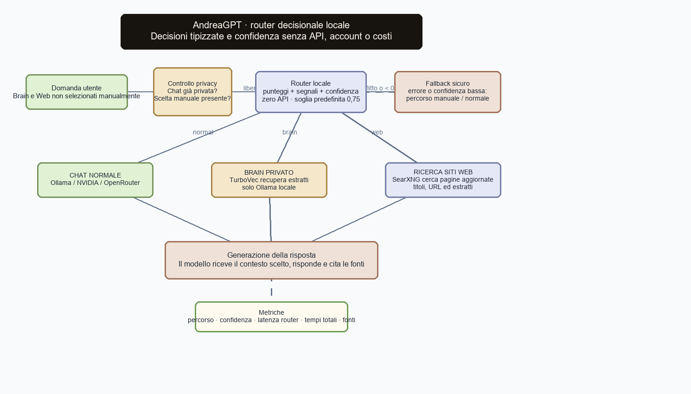
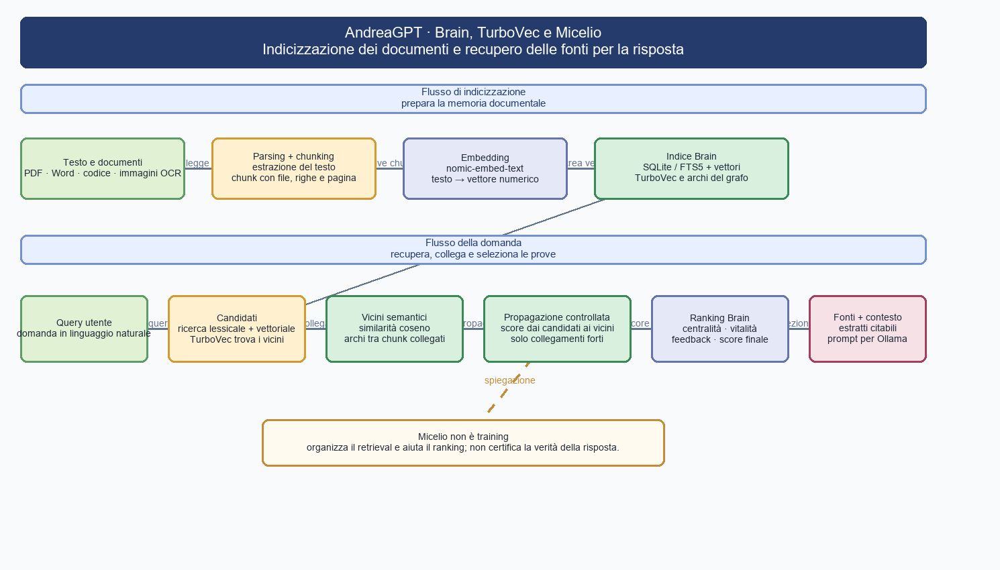

# AndreaGPT

AndreaGPT è un assistente locale con interfaccia web, backend Node/Express,
modelli Ollama, archivio documentale Brain/RAG, ricerca Web opzionale e pipeline
per OCR, YOLO, analisi immagini, trascrizione, conversione e generazione immagini.

Il progetto non è un singolo modello addestrato: è un'orchestrazione di servizi e
algoritmi che scelgono il percorso, recuperano il contesto utile e inviano una
richiesta al modello configurato.

## Architettura aggiornata

### Schema del router locale

[Schema modificabile del router locale](DRAW/router.drawio)

## Brain: come funziona

Brain è l'archivio documentale interrogabile da AndreaGPT. Non è un modello
addestrato e non modifica i pesi di Ollama: prepara il contesto che il modello
userà per rispondere.

Quando un documento entra nel Brain, il sistema:

- controlla estensione, dimensione, codifica, percorso e sicurezza del file;
- estrae il testo da file, PDF, Office, CSV, JSON, XML e codice;
- divide il contenuto in chunk conservando file, sezione, righe e pagina;
- crea un embedding per ogni chunk con nomic-embed-text tramite Ollama;
- salva testo, metadati, vettori e citazioni nell'indice;
- costruisce lo snapshot SQLite/FTS5 e, se abilitato, l'indice TurboVec;
- combina ricerca lessicale, vettoriale, refusi, feedback e collegamenti Micelio;
- seleziona pochi estratti pertinenti e li inserisce nel prompt;
- restituisce risposta, fonti, punteggi e diagnostica.

[Schema modificabile Brain/RAG](DRAW/rag.drawio)

La configurazione predefinita usa chunk di circa 1200 caratteri con sovrapposizione
di 180 caratteri. Il Brain può cercare in tutto l'archivio oppure limitarsi a una
fonte selezionata dal pannello o indicata con @percorso. Dopo aver aggiunto o
modificato documenti bisogna reindicizzare.

## Modelli e motori utilizzati

| Funzione | Modello o motore | Utilizzo |
|---|---|---|
| Chat locale rapida | openbmb/minicpm5-2b:latest | Chat, scrittura, Brain e codice con bassa latenza |
| Chat locale ragionata | qwen3:14b | Ragionamento, italiano, codice e Brain |
| Coding locale | qwen3-coder:30b-a3b-q4_K_M | Repository, codice e agente locale |
| Agente e revisione | ornith-1.5:9b | Ragionamento, strumenti, codice e conversazioni |
| Embedding Brain | nomic-embed-text | Trasforma documenti e query in vettori |
| Visione Analyze | Qwen/Qwen3-VL-2B-Instruct | Descrizione e analisi delle immagini |
| OCR principale | docTR pretrained | Lettura del testo da immagini e PDF |
| OCR fallback | Tesseract | Alternativa quando docTR non è disponibile |
| YOLO | yolo11n.pt e varianti | Detection, segmentazione, classificazione, pose e OBB |
| Generazione Image | Qwen/Qwen-Image-2.1 | Generazione immagini tramite ComfyUI |
| Generazione rapida | Viggle/Qwen-Image-2.1-viggle-turbo-v0.2.1 | Variante veloce a pochi step |
| Cloud | GLM 5.2 via OpenRouter | Ragionamento e coding a lungo contesto |
| Cloud | Gemma 4 31B via OpenRouter | Modello multimodale Google |
| Cloud | MiniMax M3 via NVIDIA API | Conversazione e contenuti generalisti |
| Ricerca Web | SearXNG, Firecrawl, Perplexity | Fonti aggiornate e News |

La lista Ollama viene aggiornata interrogando il catalogo locale: ogni modello
installato con ollama pull può comparire nell'interfaccia. I modelli cloud
richiedono le rispettive chiavi API.

## Micelio: come funziona

Micelio è il grafo semantico costruito sopra il retrieval Brain. I nodi possono
rappresentare raccolte, file o chunk; gli archi collegano contenuti con embedding
simili. Non è una rete neurale, non fa fine-tuning e non decide da solo se una
risposta è vera.

Per ogni richiesta Brain Micelio prende i candidati migliori, confronta i vettori
con la similarità coseno, collega i nodi sopra una soglia, conserva i vicini più
forti e calcola grado, centralità, betweenness, closeness e vitalità. Poi propaga
una parte dello score dai candidati verso i vicini e usa il risultato per
riordinare le fonti senza perdere la loro provenienza.

[Schema modificabile Brain, TurboVec e Micelio](DRAW/micelio-turbovec.drawio)

La dashboard mostra raccolte, file ed estratti, legami, nodi attivi/passivi,
centralità e vitalità. Il valore Affinità o micelioSupportScore indica coerenza
semantica tra domanda, risposta, fonti e grafo: non è una probabilità di verità.

## TurboVec: come funziona

TurboVec è l'acceleratore della ricerca vettoriale. Riceve gli embedding prodotti
dal Brain e individua rapidamente i candidati più vicini, evitando di confrontare
ogni documento completo a ogni domanda.

Il flusso visuale completo, dall'embedding fino al ranking Micelio, è disponibile
qui:

Il ponte è backend/utils/turbovec_bridge.py e la ricostruzione può essere avviata
da POST /api/brain/turbovec. TurboVec non genera testo, non sceglie il modello e
non certifica le risposte. Se non è disponibile, il sistema usa SQLite/FTS5 o il
percorso legacy, con possibile aumento della latenza.

## Funzionalità disponibili

### Chat

La chat normale invia la conversazione al modello scelto, in locale con Ollama o
verso un provider cloud configurato. Supporta streaming, Markdown, formule,
allegati testuali, scelta del modello, temperatura, copia, modifica e nuovo
invio. Mostra modello, token, velocità e tempi della richiesta.

### Brain

La modalità Brain cerca nell'archivio locale prima di generare la risposta.
Permette upload, import GitHub, reindicizzazione, filtro per fonte, lettura del
documento, citazioni, feedback positivo/negativo e ricostruzione TurboVec.

### Micelio

È la vista grafica della rete Brain. Serve per esplorare i collegamenti tra
raccolte, file ed estratti, capire quali nodi sono centrali e usare un nodo come
fonte della chat.

### Web

Attiva la ricerca esterna tramite SearXNG e, se configurati, Firecrawl o
Perplexity. È utile per notizie, prezzi, normativa, meteo, versioni recenti e
informazioni che cambiano. Mostra titoli, URL ed estratti delle fonti.

### OCR

Legge testo da immagini e PDF con docTR e Tesseract come fallback. Il testo
riconosciuto può essere modificato nell'interfaccia e salvato in OUTPUT/OCR.

### YOLO

Esegue detection, segmentazione, classificazione, pose e object detection
orientata. I risultati e le immagini annotate vengono salvati in OUTPUT/YOLO.

### Analyze

Invia immagini a Qwen3-VL per ottenere descrizione e analisi visuale. È diverso
da YOLO: Analyze interpreta l'immagine, YOLO restituisce oggetti, classi,
coordinate, pose o maschere.

### Image

Genera immagini con Qwen Image 2.1 tramite ComfyUI. Si possono scegliere
risoluzione, step, seed e flusso Qwen o Viggle Turbo. Il backend crea un job
asincrono, restituisce un jobId e salva il risultato in OUTPUT/Image.

### Converti

Converte PDF, DOCX, Markdown e TXT, anche in modalità multipla con ZIP. Può
correggere tabelle e tradurre Markdown tramite Ollama. I risultati sono
scaricabili dal pannello Output.

### Trascrivi

Trasforma un file audio in testo usando faster-whisper. Il risultato può essere
inserito in una nuova conversazione o salvato negli output.

### Registra

Usa MediaRecorder del browser per registrare dal microfono. Al termine invia
l'audio al percorso di trascrizione e riporta il testo nella conversazione.

### Compatta chat

Esporta la conversazione completa in Markdown mantenendo l'ordine originale.
È un'esportazione locale, non un riassunto generato dal modello, e salva il file
in OUTPUT/Compatta_chat.

### News

Costruisce edizioni su AI, paper scientifici oppure scienza e curiosità. Cerca
fonti aggiornate, applica filtri di data e categoria e produce un articolo con
citazioni. Se il redattore non è disponibile usa un fallback basato sugli
estratti trovati.

## Struttura dei file

~~~text
AndreaGPT/
├─ backend/                 Backend TypeScript e pipeline Python
│  ├─ index.ts              Server Express e tutte le API HTTP
│  ├─ brain/                Indicizzazione, embedding, store e Micelio
│  ├─ retrieval/            Token, ranking, selezione delle prove
│  ├─ grounding/            Audit delle citazioni e supporto semantico
│  ├─ context/              Costruzione del prompt e budget del contesto
│  ├─ router/               Scelta locale normal/brain/web
│  ├─ search/               Parsing e normalizzazione delle ricerche Web
│  ├─ model/                Catalogo modelli e pipeline Python
│  ├─ code/                 Agente codice, simboli e workspace
│  ├─ diagnostics/          Mainboard, tempi e tracce operative
│  ├─ config/               Configurazione applicativa
│  ├─ http/                 Test del comportamento HTTP
│  └─ utils/                OCR, PDF, worker, audio, TurboVec e helper
├─ frontend/                Interfaccia React/Vite
│  ├─ main.tsx              Entry point dell'applicazione
│  ├─ pages/                Pagina Chat
│  ├─ components/           Brain, Mainboard, conversione e impostazioni
│  ├─ model/                Selezione dei modelli dal client
│  ├─ config/               Lingua e limiti upload Brain
│  ├─ types/                Tipi condivisi del frontend
│  ├─ utils/                Storage, clipboard, stream e conversioni
│  └─ styles/               CSS dell'interfaccia
├─ ANDREA-BRAIN/            Archivio documentale e indici locali
│  ├─ documents/            Documenti personali indicizzabili
│  ├─ progetti/             Materiale dei progetti
│  └─ .index/               Manifest, SQLite, vettori e feedback
├─ OCR/                     Input e output dei processi OCR
├─ OUTPUT/                  Risultati: Image, OCR, YOLO e chat
├─ DRAW/                    Diagrammi Draw.io, SVG e PNG
├─ scripts/                 Avvio, benchmark, test e strumenti
├─ docs/                    Documentazione aggiuntiva
├─ public/                  Logo, icone e asset statici
├─ data/                    Cache e dati runtime locali
├─ searxng/                 Configurazione della ricerca Web
├─ compose.yaml             Servizi Docker AndreaGPT e SearXNG
├─ Dockerfile               Build Node + ambiente Python
├─ vite.config.ts           Dev server, proxy API e build frontend
└─ package.json              Script e dipendenze JavaScript/TypeScript
~~~

## Librerie e runtime

### JavaScript/TypeScript

| Libreria o runtime | Funzione nel progetto |
|---|---|
| Node.js >= 22.13 | Runtime backend e node:sqlite |
| TypeScript | Tipizzazione statica e controllo con tsc |
| React e React DOM | Interfaccia utente |
| Vite | Sviluppo e build frontend |
| Express | API HTTP e server statico |
| Zod | Validazione stretta dei payload |
| Ollama via HTTP/fetch | Chat ed embedding locali |
| React Markdown, remark-gfm, remark-math, rehype-katex, KaTeX | Markdown, tabelle e formule |
| Lucide React | Icone dell'interfaccia |
| fast-xml-parser | Parsing XML e documenti Office |
| adm-zip | Lettura archivi Office |
| pdf-parse | Estrazione del testo dai PDF |
| undici | Trasporto HTTP configurabile |
| dotenv e CORS | Configurazione e accesso controllato |

### Python e strumenti di sistema

| Libreria o strumento | Funzione nel progetto |
|---|---|
| PyTorch e torchvision | Inferenza dei modelli visivi |
| python-doctr | OCR principale |
| Ultralytics | Pipeline YOLO |
| Transformers, diffusers, accelerate | Qwen3-VL e Qwen Image |
| turbovec | Indice vettoriale accelerato |
| faster-whisper | Trascrizione audio |
| Pillow, OpenCV, NumPy, SciPy | Immagini e calcolo numerico |
| pdf2docx e pypdfium2 | Gestione e conversione documenti |
| Tesseract | Fallback OCR |
| Poppler | Estrazione e rasterizzazione PDF |
| Pandoc e LibreOffice | Conversione documenti |
| FFmpeg | Supporto ai formati audio/video |

## Concetti chiave implementati

- **RAG locale:** il modello riceve estratti selezionati, non l'intero archivio.
- **Chunk con provenienza:** ogni passaggio conserva file, righe, pagina e citazione.
- **Retrieval ibrido:** FTS5, embedding/coseno e ranking combinato.
- **Snapshot SQLite atomico:** il manifest pubblica lo store attivo senza interrompere
  le generazioni precedenti.
- **TurboVec:** accelera la ricerca dei candidati senza generare testo.
- **Micelio:** grafo di vicinanza che può propagare score; non è fine-tuning.
- **Grounding:** controlla citazioni, fonti inesistenti e numeri non supportati.
- **Router locale:** seleziona il percorso senza inviare la domanda fuori dal
  computer; Brain e Web manuali restano prioritari.
- **Prompt con budget:** limita cronologia e fonti al contesto disponibile.
- **Lazy loading:** Brain e pipeline costose si caricano solo quando servono.
- **Sicurezza del workspace:** payload, dimensioni, percorsi, symlink e accesso LAN
  vengono controllati.
- **Job asincroni:** la generazione immagini restituisce un jobId.
- **Diagnostica riproducibile:** tempi e fasi sono esposti nella Mainboard.

## Riassunto finale

AndreaGPT unisce una chat locale con un archivio Brain capace di cercare nei
documenti, un grafo Micelio che organizza le relazioni semantiche, TurboVec che
accelera il recupero e controlli di grounding che mostrano le fonti usate. Attorno
a questo nucleo offre ricerca Web, OCR, YOLO, analisi immagini, generazione Image,
conversione documenti, trascrizione e registrazione audio, esportazione delle chat
e News. Il modello genera la risposta, ma la qualità dipende dal modello scelto,
dai documenti indicizzati e dalla verifica delle fonti.
