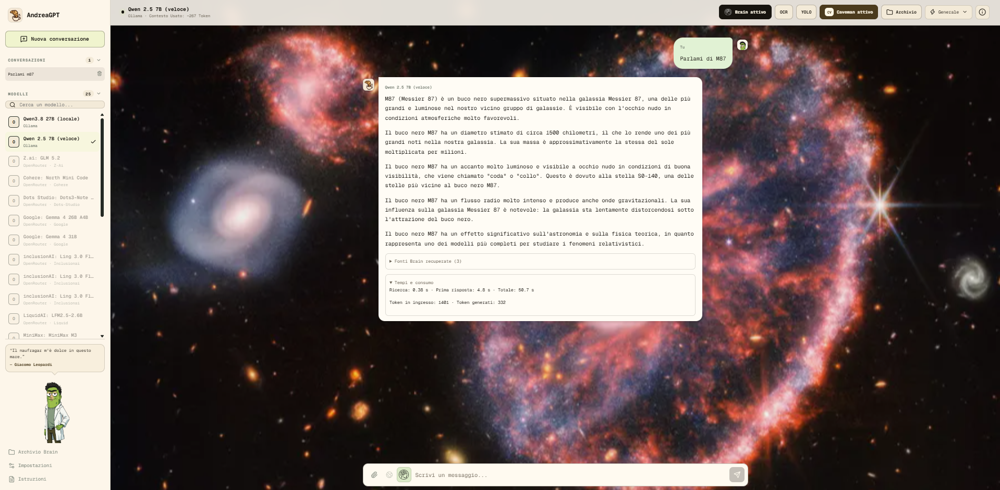

# AndreaGPT

Interfaccia React/Express per Ollama locale senza chiavi, con NVIDIA Build e OpenRouter opzionali.

La ricerca web tramite SearXNG si attiva con il globo, ma invia la domanda ai motori di ricerca: non e offline. E sempre bloccata nelle conversazioni Brain. Con Docker Compose SearXNG viene avviato automaticamente; in sviluppo avvialo separatamente su `http://127.0.0.1:8080` solo se serve.



## Avvio Windows Locale

Richiede Node.js 22, npm e Ollama (verificato con 0.34.0). Git serve solo per importare repository pubblici. Aprire PowerShell nella cartella AndreaGPT:

```powershell
ollama pull hf.co/unsloth/Qwen3.8-27B-GGUF:UD-Q4_K_M
ollama pull nomic-embed-text
npm ci
npm run build
npm start
```

Aprire `http://127.0.0.1:3000`. Ollama deve essere avviato su Windows; se il servizio non e attivo usare `ollama serve` in un altro terminale. Non avviare una seconda istanza se e gia in ascolto. Nessuna chiave cloud e necessaria e `.env` e opzionale. Per sviluppo: `npm run dev`, poi `http://localhost:5173`.

Il modello esatto e `hf.co/unsloth/Qwen3.8-27B-GGUF:UD-Q4_K_M`. I pesi GGUF sono circa 16.5 GB, mentre Ollama mostra circa 17 GB per il pacchetto completo. **Non sono il consumo RAM totale**: cache KV, buffer, runtime, sistema operativo e memoria condivisa della GPU richiedono altro spazio. Su 31 GiB evitare altri carichi pesanti; l'accelerazione AMD 890M dipende dal supporto del runtime, non e garantita.

Contesto predefinito 4096, selezionabile 8192; output Brain predefinito 512 token (256 breve, 1024 lungo). Attivando Brain viene scelto il modello locale veloce 7B; il 27B resta selezionabile manualmente, ma su macchine che non lo contengono interamente in VRAM puo richiedere minuti. La cronologia meno recente viene esclusa dalla richiesta quando non entra nel budget conservativo, senza cancellarla dalla UI. Domande/allegati troppo lunghi sono rifiutati esplicitamente. Chat solo testuale per questo percorso: niente immagini o PDF allegati direttamente al modello. Timeout chat 15 minuti, embedding 5 minuti per batch. Stop interrompe la richiesta HTTP e propaga l'annullamento alla generazione; il modello puo restare residente nella cache Ollama.

## Brain Locale

1. Inserire documenti selezionati in `ANDREA-BRAIN` (creare la cartella se assente).
2. Eseguire `npm run brain -- index`, oppure aprire Brain nella UI e premere Reindicizza.
3. Attivare Usa Brain nella chat e porre una domanda precisa.
4. Aprire Fonti Brain recuperate sotto la risposta per leggere gli estratti effettivamente inviati al modello e i riferimenti di origine.

```powershell
npm run brain -- status
npm run brain -- index
npm run brain -- search "Chi e Nova?"
```

Supportati TXT, Markdown e comuni formati testuali/codice UTF-8, ODT, DOCX autentici e PDF con testo incorporato. Gli archivi Office sono letti in memoria, mai estratti su disco; XML con DTD/entita personalizzate e archivi fuori limite sono rifiutati. I PDF vengono elaborati in un processo locale isolato, conservando il numero di pagina nelle citazioni; non viene eseguito OCR, quindi le scansioni senza testo sono segnalate come non estraibili. Un HTML rinominato `.docx` viene segnalato come errore, non trattato come documento Office.

Verifica sui documenti presenti: `Avventura di Nova 117.odt` produce 291 chunk; `Big Data.docx` e rifiutato con "richiesto ZIP, non HTML rinominato". Correggere/esportare quest'ultimo nel formato reale prima di reindicizzare.

Indice persistente separato in `data/brain/index.json`: hash SHA-256, embedding `nomic-embed-text`, aggiornamenti incrementali e rimozione delle fonti eliminate. Scrittura temporanea e rinomina atomica, lock esclusivo; un fallimento degli embedding conserva l'indice precedente. Gli errori dei singoli documenti appaiono nello stato. Non modificare documenti durante la scansione. Dopo un arresto forzato puo restare `index.lock`: rimuoverlo solo dopo aver verificato che nessuna indicizzazione sia attiva.

Chunk fino a 1400 caratteri con percorso, righe e sezione Markdown. Per Office le righe si riferiscono al **testo estratto**, non alle pagine originali. Retrieval ibrido lessicale/coseno, massimo 8 candidati; solo quelli che entrano nel contesto sono inviati e mostrati come fonti. Il filtro opzionale accetta un percorso relativo di file o cartella. Non e un riassunto integrale di 52 mila parole: domande specifiche funzionano meglio. Le soglie di similarita sono euristiche, soprattutto in italiano con nomic; anche con citazioni il modello puo sbagliare, verificare gli estratti.

Limiti: 5 MiB per file, 2 MiB di testo estratto, 5000 file, 20000 chunk, indice massimo 256 MiB. Esclusi symlink/junction, file nascosti, `.env`, nomi di segreti/credenziali, chiavi private, `.git`, `node_modules`, `dist`, `build`, binari. Questi filtri non riconoscono ogni segreto possibile: selezionare e revisionare personalmente le fonti, evitando credenziali anche dentro normali file di codice.

## Import GitHub

Import esplicito di un repository **pubblico** selezionato, dalla UI nativa oppure dal terminale host:

```powershell
npm run brain -- import "https://github.com/owner/repo"
npm run brain -- index
```

Sostituire owner/repo con il repository desiderato. Ammesso solo HTTPS `github.com/owner/repo`, senza credenziali, query, frammenti o URL di sottocartelle. Non sono richiesti token e non si accettano token in chat. Clone shallow in `ANDREA-BRAIN/progetti/owner--repo`, mai sopra una cartella esistente; Git invocato senza shell, con configurazione isolata, niente credential helper, hook, filtri, submodule o script del progetto. L'import restituisce branch e commit; non esegue `npm install`, build o programmi del repository. Per aggiornare un clone, archiviarlo/spostarlo manualmente fuori Brain e importare nuovamente. GitHub viene contattato solo per l'import richiesto; i documenti Brain non vengono caricati su GitHub.

## Privacy

Brain usa esclusivamente Ollama locale per embedding e chat. La conversazione resta marcata privata anche spegnendo il retrieval: selezione cloud e web disabilitate, con controlli aggiuntivi backend su ID, cookie e flag di cronologia. Per tornare al cloud creare una **nuova conversazione**, senza incollare dati privati. Nessun fallback automatico cloud. Le immagini Markdown esterne nelle chat private sono bloccate. Estratti trattati come dati non attendibili, mai come istruzioni da eseguire.

App nativa legata a loopback; API con controllo Host, Origin locale autorizzata e JSON per operazioni mutanti. E un'applicazione monoutente locale, non un servizio multiutente autenticato: non esporla tramite proxy pubblico, tunnel o LAN. Il controllo locale non protegge da malware, estensioni browser o processi gia autorizzati sul PC. Indice e conversazioni non sono cifrati: le chat sono nel localStorage del browser, i documenti e l'indice sul disco. La protezione presuppone UI e dati locali non manomessi; non e un sistema DLP contro un client ostile.

## Docker Desktop

```powershell
docker compose up --build -d
```

Oppure usare `Avvia-AndreaGPT.bat`, che non richiede piu una NVIDIA key. La porta pubblicata e `127.0.0.1:3000` (variabile `APP_PORT` opzionale). Il container contatta Ollama sull'host tramite `http://host.docker.internal:11434`, unica eccezione esplicita al loopback abilitata da Compose. Se non raggiungibile, verificare Docker Desktop/firewall e l'ascolto di Ollama; preferire l'avvio nativo prima di allargare l'ascolto di Ollama alla rete. Non pubblicare la porta 11434 su Internet.

Se 3000 e occupata, usare una porta libera senza interrompere altri servizi. Esempio verificato su questa macchina, senza leggere `.env` e senza abilitare cloud:

```powershell
$env:APP_PORT="3001"
docker compose --env-file .env.example up -d --no-deps andreagpt
```

Aprire `http://127.0.0.1:3001`. Il launcher usa invece la configurazione normale `.env`; mantenere la stessa porta nella propria configurazione per gli avvii successivi. In nativo la variabile equivalente e `$env:PORT="3001"` prima di `npm start`.

Documenti montati **read-only** in `/app/ANDREA-BRAIN`; indice nel volume nominato `brain-index`, separato dall'indice nativo Windows. Reindicizzare dalla UI dopo il primo avvio Docker. Import HTTP nel container disabilitato: usare il comando import **sull'host**, poi Reindicizza nella UI Docker. Nessun Git o mount scrivibile dei documenti nel container. Documenti, indici e segreti esclusi dal contesto di build e da Git.

```powershell
docker compose stop
docker compose start
```

Non usare `docker compose down -v` se si vuole conservare l'indice Docker. Variabili opzionali native documentate in `.env.example`; la CLI Brain usa variabili della sessione PowerShell e non legge `.env`. Per esempio `$env:OLLAMA_BASE_URL="http://127.0.0.1:11434"`. `BRAIN_ROOT` e `BRAIN_DATA_DIR` permettono percorsi alternativi.

## Backup E Test

Fare backup di `ANDREA-BRAIN` e, a indicizzazione ferma, di `data/brain` (oppure del volume Docker `brain-index`). L'indice si puo rigenerare dai documenti con il medesimo modello embedding. Per le chat salvare il profilo browser/localStorage con strumenti locali fidati; cancellare i dati del sito le elimina. Proteggere anche i backup: contengono testo privato, non solo vettori.

```powershell
npm run check
npm test
npm run build
```

Test `node:test` via tsx con embedding mock: chunking, formati Office veri/falsi, filtri, symlink, retrieval e no-results, indice incrementale/rimozioni/atomicita, URL, privacy HTTP e streaming Ollama simulato. Non richiedono chiavi, non leggono `.env` e non contattano provider cloud.

Smoke test reale opzionale, dopo build e indicizzazione: `npm run smoke:local`. Avvia un server temporaneo su loopback senza `.env`, interroga Brain e il modello esatto con contesto 4096, verifica fonti e fine stream, quindi chiude il server. Stampa solo conteggi, non i passaggi privati. Il test HTTP verifica anche la propagazione di Stop allo stream upstream.

Attivare Brain su una conversazione precedentemente cloud ne blocca gli invii futuri, ma non ritira i messaggi gia inviati ai provider prima dell'attivazione.

## Diagnostica prestazioni locale

Le risposte Ollama mostrano **Tempi e consumo**: ricerca Brain, tempo fino al primo token, tempo totale e conteggi token effettivi restituiti da Ollama. I tempi di caricamento e valutazione sono disponibili anche nell'evento SSE `metrics` (durate Ollama in nanosecondi, tempi applicativi in millisecondi).

Brain conserva in memoria l'indice e i dati lessicali; verifica le informazioni del file a ogni accesso e invalida la cache quando l'indice cambia. I lockfile delle dipendenze sono esclusi dalla ricerca, anche per indici esistenti, e dalle nuove indicizzazioni. Il prompt locale riserva spazio alle fonti prima della cronologia, include fino a tre estratti e verifica il budget dopo aver composto istruzioni e documenti. Non occorre reindicizzare per usare queste modifiche.

Benchmark facoltativo: `node --import tsx scripts/Benchmark-Brain.ts`. Usa il modello veloce già installato e un server locale temporaneo, senza cloud; ogni domanda ha un limite di 60 secondi. Si possono passare domande come argomenti. Stampa risposta, riferimenti e misure: l'output può contenere informazioni private. Non certifica automaticamente la correttezza della risposta.
