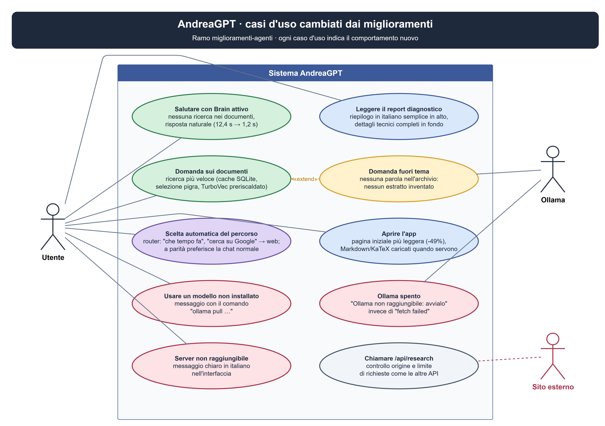

# Miglioramenti di AndreaGPT con agenti: report finale

Data: 1 ottobre 2026 · Ramo git: `miglioramenti-agenti` (creato da `stabile`, che è
rimasto intatto).

## In breve

- **51 agenti** su 8 settori. Per ogni settore un capo ha misurato lo stato attuale e
  ha proposto al massimo 3 miglioramenti. Ogni proposta è stata realizzata da un
  operatore in una copia isolata del progetto e poi controllata da un verificatore,
  che aveva il compito di bocciarla.
- **21 proposte provate.** Il verificatore ne ha approvate 17 e bocciate 4. Una delle
  17 era un doppione, quindi ne sono state applicate **16**.
- **Prima / dopo complessivo:**

| Controllo | Prima (`stabile`) | Dopo (`miglioramenti-agenti`) |
|---|---|---|
| Test automatici | 65 test, 62 passano | 75 test, 73 passano |
| Controllo TypeScript | OK | OK |
| Benchmark router (con 8 casi nuovi aggiunti) | 8 errori | 0 errori |
| "CIAO" con Brain attivo | 12,4 s, 3 fonti a caso, risposta goffa | 1,2 s, nessuna fonte, risposta di saluto |
| Peso della pagina iniziale | 940 KB | 482 KB (−49%) |
| Logo | 152 KB | 15 KB (−90%) |

I 2 test che falliscono ancora c'erano già prima e dipendono dall'ambiente: manca un
componente nativo per convertire i file DOCX/ODT.

Regola usata: una modifica entra solo se il beneficio è **misurato due volte**, una
dall'operatore e una dal verificatore, con lo stesso comando prima e dopo, e se nessun
test che prima passava si rompe.



[Schema modificabile dei casi d'uso](../DRAW/casi-uso-miglioramenti.drawio)

---

## Miglioramenti applicati (16)

### 1. Brain e ricerca nei documenti

**Saluti senza ricerca nel Brain** (`backend/retrieval/evidence_policy.ts`, `backend/index.ts`)
- *Problema:* con il Brain attivo, "CIAO" cercava nei documenti. Al modello arrivavano
  3-5 estratti senza relazione col saluto e lui rispondeva "fornisci una domanda reale".
- *Soluzione:* la funzione `isSmallTalk` riconosce i messaggi fatti solo di parole di
  cortesia (ciao, grazie, ok, come stai…), al massimo 4. Per questi messaggi la ricerca
  nel Brain viene saltata. La conversazione resta privata e in locale.
- *Prova:* saluti che arrivano alla ricerca: da 11/11 a 0/11. Domande vere scambiate per
  saluti: 0/18. "ciao, cos'è HDFS?" resta una domanda.
- *Prova dal vivo:* "CIAO" passa da 12,4 s a 1,2 s, con 0 fonti.

**Nessun estratto se nessuna parola della domanda è nell'archivio** (`backend/brain/brain.ts`)
- *Problema:* con il modello di embedding usato, qualsiasi testo risulta "abbastanza
  simile" a qualsiasi documento. Per questo anche "ricetta della carbonara" riceveva 5
  estratti.
- *Soluzione:* se nessuna parola della domanda compare nell'archivio, non si inviano
  estratti.
- *Prova:* domande fuori tema con estratti: da 14/14 a 5/14. La qualità sulle domande
  pertinenti resta uguale: miglior estratto giusto in 16/18 casi, nei primi 5 in 18/18.

### 2. Router (scelta automatica chat / Brain / web)

**A parità di punteggio, chat normale invece di web** (`backend/router/router.ts`)
- *Prova:* sui casi nuovi del benchmark, da 30/35 a 35/35.

**Frasi colloquiali per il web** ("che tempo fa", "trova online", "cerca su Google")
- *Prova:* da 30/33 a 33/33. I casi gestiti in automatico passano dall'85% al 94%.

### 3. Report diagnostico leggibile

**Riepilogo in italiano semplice in alto, dettagli tecnici in fondo**
(`frontend/utils/diagnostic_report.ts`, spostato fuori da `Chat_page.tsx` e coperto da un test)
- *Prima:* metriche grezze ("indexStatusMs: 5.637232999957632", valori in nanosecondi),
  chiavi in inglese tecnico, la parola WARNING anche quando tutto andava bene.
- *Dopo:* in alto c'è un RIEPILOGO con:
  - esito;
  - tempo totale;
  - modello usato;
  - quante fonti;
  - per ogni avviso, se è **[Solo informativo]** o **[Da controllare]** e cosa fare.

  I numeri sono arrotondati (ms, s, MB) e i nomi sono in italiano. Le metriche grezze
  restano tutte nella sezione "DETTAGLI TECNICI": non si perde nessuna informazione.
- *Prova:* sullo stesso report di esempio:
  - decimali grezzi nella parte leggibile: da 21 a 0;
  - valori in nanosecondi: da 7 a 0;
  - chiavi tecniche: da 37 a 0;
  - riepilogo nelle prime righe: no → sì.

Esempio della nuova parte iniziale:

```text
RIEPILOGO
- Esito: 1 avviso da guardare
- Tempo totale: 12,40 s
- Modello: MiniCPM5 2B (locale) (Ollama)
- Fonti usate: 1 dal Brain, 0 dal Web
- Avvisi:
  • [Solo informativo] Alcuni estratti trovati non sono stati inviati al modello per
    restare nel limite di lunghezza. È normale. Nessuna azione necessaria.
  • [Da controllare] Alcune frasi della risposta non hanno una citazione o contengono
    numeri non trovati nelle fonti. Cosa fare: controlla quelle frasi confrontandole
    con le fonti.
...
TEMPI E NUMERI
- Ricerca fonti nel Brain: 366 ms
- Estratti trovati: 5
- Estratti inviati al modello: 3
- Attesa prima parola della risposta: 6,84 s
- Caricamento modello: 3,61 s
- Memoria usata dal server: 247 MB
- Somiglianza tra risposta e fonti: 71%
```

### 4. Prestazioni della ricerca

In tutti e tre i casi le fonti restituite sono **identiche** prima e dopo: cambia solo
la velocità.

| Modifica | Prima | Dopo |
|---|---|---|
| TurboVec preriscaldato quando si carica il Brain (prima domanda) | 571 ms | 4 ms |
| Selezione dei passaggi calcolata solo quando serve | 9,5-19 ms | 1,9-2,6 ms |
| Chunk del database SQLite tenuti in memoria (domande successive) | ricerca 39-41 ms | ricerca 18-21 ms (−50%) |

### 5. Interfaccia

- **Markdown e formule (KaTeX) caricati solo quando servono.** La pagina iniziale passa
  da 940 KB a 482 KB, quindi l'app si apre più in fretta.
- **Messaggio chiaro quando il server non risponde.** Prima appariva l'errore tecnico
  del browser ("Failed to fetch"), ora c'è una frase in italiano. Sono stati aggiunti 3
  test.
- **Logo ridotto a 128 px**: da 152 KB a 15 KB. Nell'interfaccia il logo è mostrato
  piccolo (favicon e avatar), quindi 128 px bastano.

### 6. Test e pulizia

- **Test HTTP aggiornato** al catalogo modelli attuale (la vecchia lista non aveva
  qwen3-coder e ornith). Ora fa eseguire anche un test di `chat_compact` che nessuno
  lanciava.
- **Rimosso codice morto:** `pdf_extract.mjs` non era usato da nessuno e la dipendenza
  `pdf-parse` pesava circa 92 MB in node_modules. I PDF vengono già letti da
  `@firecrawl/anydoc`.

### 7. Sicurezza e robustezza

- **`/api/research` ora ha gli stessi controlli delle altre API**: origine, tipo di
  contenuto e limite di richieste al minuto. Prima un sito esterno poteva chiamarla
  senza limiti.
  - *Prova:* origine estranea 400 → 403; 300 richieste di fila: prima mai bloccate,
    ora 64 bloccate.
- **Modello non installato.** Prima appariva "Ollama HTTP 404: model 'qwen3:14b' not
  found". Ora: *"Il modello "qwen3:14b" non è installato in Ollama. Per scaricarlo apri
  il terminale e scrivi: ollama pull qwen3:14b"*.
- **Ollama spento.** Prima appariva "fetch failed". Ora: *"Ollama non raggiungibile su
  …: avvia Ollama (app Ollama oppure "ollama serve") e riprova."*

---

## Proposte bocciate (4) e perché

| Proposta | Perché è stata scartata |
|---|---|
| Router: riconoscere "i miei appunti/documenti" come Brain | Il benchmark migliorava (31→34/34), ma frasi normali come "Come proteggo i miei documenti con una password?" finivano nel Brain. |
| Prompt Brain: regola esplicita per i messaggi di conversazione | Le risposte ai saluti miglioravano, ma su "Cos'è un data warehouse?" le frasi con citazione scendevano da 3 a 1, in due prove su due. Il problema dei saluti è comunque risolto dalla modifica 1. |
| Niente avvisi nel report per situazioni normali | Il risultato "0 avvisi" dipendeva dal momento della prova: TurboVec era ancora in costruzione. Rifatta la prova, l'avviso tornava. |
| Brain: indicizzare DOCX/ODT quando il convertitore nativo è bloccato | La regola per riconoscere "convertitore bloccato" era troppo larga: anche un documento senza testo avrebbe mostrato un messaggio sbagliato. |

Scartata anche una proposta doppia: due settori diversi avevano risolto i saluti in
modo indipendente. È stata tenuta la versione più semplice, 3 righe in `index.ts`
invece di 13.

---

## Problemi trovati ma non risolti

1. **Il modello piccolo a volte risponde con parole in cinese.** Su 6 saluti, 2 risposte
   di MiniCPM5 2B contenevano caratteri cinesi, sia in chat normale sia con il Brain. Il
   problema c'era già prima e non dipende da queste modifiche: le istruzioni "rispondi in
   italiano" vengono già inviate. Possibili rimedi da valutare:
   - usare `qwen3:14b` come modello predefinito;
   - rigenerare la risposta quando contiene caratteri cinesi.
2. **TurboVec non funziona in locale fuori da Docker.** Manca il pacchetto Python
   `turbovec`, quindi la ricerca usa il metodo standard, più lento. Dentro Docker è
   installato.
3. **Il benchmark di retrieval non è adatto al Brain attuale.** Cerca documenti che non
   ci sono (Nova, Petri…) e si blocca senza turbovec. Andrebbe aggiornato con domande
   su `Big_Data_Sergy.md`.
4. **Due test DOCX/ODT falliscono** per un componente nativo mancante su questo PC. Non
   è un errore del codice.

---

## Come provare o tornare indietro

```powershell
cd C:\Users\utente\Desktop\AndreaGPT2
git log --oneline stabile..miglioramenti-agenti   # i 16 miglioramenti
npm test                                          # 75 test, 73 passano
npm run benchmark:router
git switch stabile                                # torna alla versione precedente
git switch miglioramenti-agenti                   # torna ai miglioramenti
```

Per usarli definitivamente: `git switch stabile` e poi `git merge miglioramenti-agenti`.
